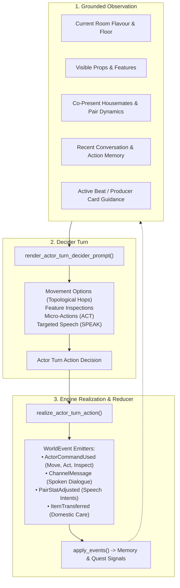
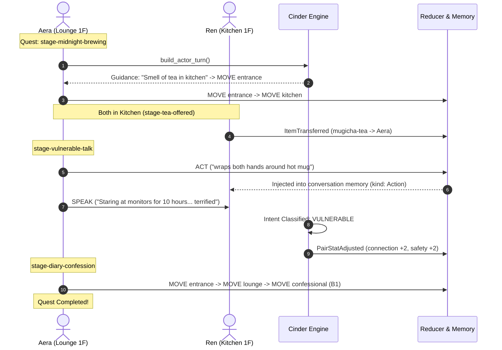

# Actor Actions & Reality-Show Autonomy: AERA

> *"A housemate is not an automaton following waypoints. A housemate is a person navigating ambition, fatigue, attraction, and self-consciousness under twenty-four-hour surveillance."*

---

## 1. Architecture of Autonomy in Cinder

In *Aera*, housemates navigate the Da'an townhouse autonomously through Cinder's multi-stage actor turn pipeline:

---

## 2. Complete Actor Action Vocabulary

To support both **Event Cards** (macro environmental interventions) and **Relationship Cards** (micro interpersonal nudges), housemates possess a focused action vocabulary:

| Action | Command ID | Target Mode | Effects | Mechanical Purpose & Card Connection |
| :--- | :--- | :--- | :--- | :--- |
| **Move / Navigate** | `move` | `room` | `move_actor` | Moves between rooms. Drives spatial convergence (seeking someone out) or sudden retreats (the **Cold Shoulder** card). Uses shortest-path multi-hop pathfinding across villa floors. |
| **Micro-Gesture** | `act` | `none` (freeform text) | `remember_in_room` | Generates non-verbal body language (e.g. *fidgets with ring*, *looks away*, *wraps hands around warm mug*). Injected into co-present actors' `recent_memory` with `kind: Action`. |
| **Inspect Feature** | `inspect_feature` | `feature` | `observe_feature` | Interacts with room props (stove, pour-over station, editing monitor, record player). Grounds domestic habits and satisfies quest objectives. |
| **Targeted Speech** | `speak` | `actor_optional` | `dialogue`, `pair_stat` | Speaks to a roommate. Evaluated against relational speech intents (`WARM`, `FLIRTY`, `COLD`, `VULNERABLE`). Modifies `connection`, `safety`, and `attraction`. |
| **Domestic Transfer** | `give` / `transfer` | `actor` | `transfer_item`, `pair_stat` | Hands tea, food, or camera gear to another actor. Triggers **Acts of Service** relationship dynamics (`safety` +2, `connection` +1). |
| **Rest / Settle** | `rest` | `context_label` | `remember_in_room`, `stat_boost` | Sits on sofa, loungers, or tatami. Anchors co-presence (`shared_room_tick` builds safety over time). |
| **Diary Confession** | `confess` / `interview`| `none` | `record_interview`, `advance_objective`| Executed in the soundproof B1 Diary Room (`confessional`). Generates private commentary contrasting public behavior for the evening broadcast cut. |

---

## 3. Relational Speech Intents & Dynamics

When housemates speak, direct speech is evaluated against `content/aera/intents.json`:

* **`NONE`**: Neutral, practical, or transactional dialogue. No stat shifts.
* **`WARM`**: Gentle support, openness, or appreciation.
  * `connection` $+1$, `safety` $+1$.
* **`FLIRTY`**: Teasing, romantic tension, or direct romantic interest.
  * `attraction` $+1$.
* **`COLD`**: Defensive, dismissive, or cutting remark.
  * `connection` $-1$, `safety` $-1$.
* **`VULNERABLE`**: Revealing personal fatigue, past hurt, insecurity, or honest emotion.
  * `connection` $+2$, `safety` $+2$.

Spoken dialogue between actors emits `speech_between:{actor_a}:{actor_b}` signals in the reducer, advancing relationship quests and card triggers.

---

## 4. How Actions Power Producer Cards

### A. Relationship Cards (Micro Nudges)
* **The Cold Shoulder**: When dialogue turns vulnerable or flirty, an actor with low `confidence` or high `uncertainty` triggers `move <other_room>` mid-exchange. Leaves the partner overthinking (`attraction` +2, `confidence` -2).
* **Acts of Service**: An actor executes `give mugicha-tea aera`. Unlocks intimate domestic connection (`safety` +2, `connection` +2).
* **The Third Wheel**: When Pair A & B are co-present in the Lounge, Actor C enters with a tray of iced tea, breaking romantic momentum.

### B. Event Cards (Macro Interventions)
* **Late-Night Pour-Over**: Two actors converge in the kitchen past midnight. Prepping hot drinks satisfies the stage objective and unlocks the morning episode cut.
* **Studio Rough-Cut Review**: Aera and a collaborator in the 2F Design Studio inspecting the editing bay and conversing. Unlocks Aera's creative confidence.

---

## 5. Reference Integration Scenario: *"The Late-Night Pour-Over"*

The complete flow is verified end-to-end in [`cinder-core/tests/aera_map_tour.rs`](file:///Users/li-hsuanlung/Projects/cinder/cinder-core/tests/aera_map_tour.rs):

This verification ensures that:
1. Multi-hop spatial pathfinding guides housemates accurately across multiple villa floors.
2. Silent body language (`act`) is remembered by co-present roommates.
3. Item transfers work cleanly between NPCs.
4. Speech intents mutate pair stats dynamically.
5. All transitions produce deterministic narrative lines and quest signals.
