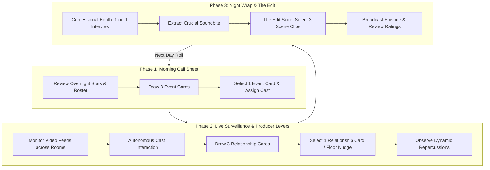

# Core Loop & Progression: AERA

> *"A shoot day is twenty hours of surveillance compressed into twenty minutes of entertainment."*

---

## 1. The Daily Rhythm: Three-Phase Loop

Each day in *Aera* follows a strict three-phase production rhythm:

---

## 2. Phase Breakdown

### Phase 1: Morning Call Sheet (Strategy & Environment)
* **Time**: 08:00 – 10:00
* **Player Role**: Production Manager.
* **Actions**:
  1. **Status Board**: Check the current status of the four housemates:
     - Physical stats: `stamina` and `hunger`.
     - Psychological stats: `confidence` and `safety`.
     - Pairwise affinities: `attraction` and `connection`.
  2. **Network Directive**: The daily email from Executive Producer Morrison specifying today's target (e.g., *"We need eyes on Mio today"*, or *"Get Ren out of his shell"*).
  3. **Event Card Draft**: Draw 3 random **Event Cards** from the deck.
     - Choose 1 card to play.
     - Assign specific housemates if the card requires a pairing (e.g. *Grocery Run: Ren + Mio*).

---

### Phase 2: Live Surveillance & Producer Levers (Observation & Nudges)
* **Time**: 12:00 – 20:00
* **Player Role**: Control Room Director.
* **Core Commands**:
  - `switch-feed <room>` / `go <room>`: Focus the control room switcher on a specific room (`kitchen`, `lounge`, `patio`, `studio`, `dining-room`, `girls-room`, `guys-room`).
  - `follow <actor>`: Lock the active camera onto a specific housemate as they move through the house.
  - `look <feature>`: Inspect subtle micro-behaviors (e.g., *the uneaten bowl of soup*, *the body language between Mio and Daichi at the counter*).
* **The Afternoon Floor Nudge**:
  - Midday, tensions reach a plateau. The system deals **3 Relationship Cards** to the player.
  - The player selects 1 card to deploy via floor PA or whisper mic (e.g., *"The Vulnerability Push: Ask Daichi about his last ex"*).
  - The player observes how the cast reacts in real-time.

---

### Phase 3: Night Wrap & The Edit (Extraction & Assembly)
* **Time**: 21:00 – 01:00
* **Player Role**: Confessor & Post-Production Editor.
* **Step 1: The Confessional Booth (`confessional <actor>`)**:
  - Summon one housemate into the soundproof Diary Room.
  - Choose one of three probing producer questions:
    - *The Empathic Probe*: Focuses on their private feelings and doubts (raises `connection` with producer, restores `safety`).
    - *The Provocative Probe*: Pushes them to comment on another housemate's hidden motives (generates a spicy soundbite, lowers `safety`).
    - *The Reality Check*: Forces them to confront an uncomfortable truth about themselves (shifts `confidence`).
  - The housemate's response generates a **Golden Soundbite** for the edit.

* **Step 2: The Daily Broadcast Assembly**:
  - In the [`studio`](file:///Users/li-hsuanlung/Projects/cinder/content/aera/locales/en/rooms.json#L99), the player reviews the day's automatically tagged clips:
    - *Morning Event Footage* (2 clips available).
    - *Afternoon Nudge Fallout* (2 clips available).
    - *Unscripted Background Banter* (2 clips available).
  - The player selects **3 Clips + 1 Confessional Soundbite** to broadcast as the daily 22-minute episode.

* **Step 3: Ratings & Social Media Feedback**:
  - The broadcast airs overnight.
  - Metrics evaluated:
    - **Drama / Friction Score**
    - **Romance / Tension Score**
    - **Wholesome / Chemistry Score**
  - Next morning: Producer reviews viewer ratings, trending tweets, and morning housemate reactions.

---

## 3. The Two-Day Narrative Arc ("The Pilot Shoot")

### Day 1: Arrivals & The Welcome Dinner
* **Theme**: First Impressions, Posturing, and Insecurity.
* **Day 1 Goal**: Break the ice. Force the cast out of polite corporate pleasantries into initial emotional vulnerability.
* **Key Milestones**:
  - Morning/Afternoon: Move-in, room choices, unpacking.
  - Evening: Preparing the first shared dinner. Seating arrangements at the dining table.
  - Night: Bedroom debriefs (girls debriefing boys; boys debriefing girls) + First Confessional.
  - Episode 1 Broadcast: Establishes the cast's public personas.

### Day 2: The Spark & The House Meeting
* **Theme**: Jealousy, Confrontation, and Romantic Momentum.
* **Day 2 Goal**: Convert initial sparks into real choices; push unspoken grievances to the surface.
* **Key Milestones**:
  - Morning: Overnight ratings review. Morning coffee and workout dynamics.
  - Afternoon: Paired errand or group task driven by the Event Card.
  - Evening: An unscripted or engineered **House Meeting / Game Night** over wine. A secret crush is confessed or a chore grievance erupts.
  - Late Night: Final Confessionals and the Season Pilot assembly.
  - Finale: The Network Executive calls with the final verdict on the series.
