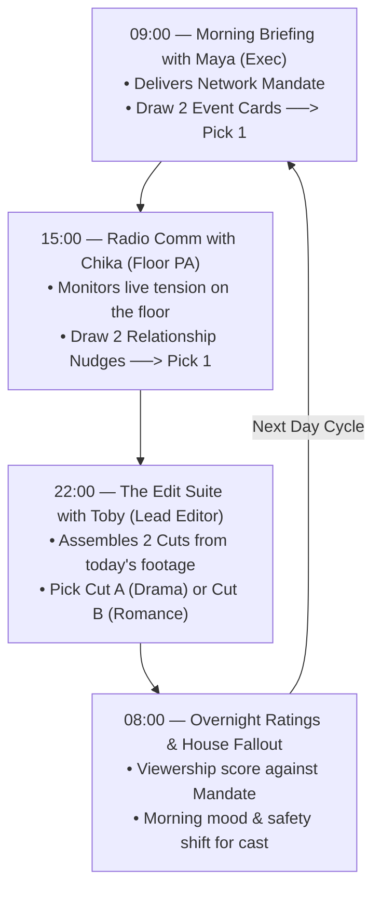

# Core Loop & Progression: AERA

> *"A shoot day is twenty hours of surveillance compressed into three executive calls with your crew."*

---

## 1. The Daily Rhythm: The 3-Conversation Crew Loop

Rather than forcing the player to navigate multiple abstract mini-games or spreadsheet menus, each day in *Aera* is driven by **three high-stakes conversations with your production team**:

---

## 2. Phase-by-Phase Breakdown

### Phase 1: 09:00 — The Call Sheet with Maya (Executive Producer)
* **Location**: Control Room / Video Village.
* **The Scene**: Maya steps in with an iced coffee and an iPad displaying overnight audience metrics.
* **The Network Mandate**: Maya announces what the suits upstairs are demanding today:
  * *Conflict Mandate*: *"Viewers say the house is too quiet. We need blood or someone crying."*
  * *Romance Mandate*: *"The 18–34 demo wants butterflies. We need a spark or a confession."*
  * *Cringe / Buzz Mandate*: *"We need awkward friction or someone embarrassing themselves."*
* **The Choice (Event Cards)**: Maya presents **two Event Cards** pitched by network programming:
  * E.g., Option A: *"Grocery Budget Squeeze"* (Forces Ren + Mio into logistical friction).
  * E.g., Option B: *"AC & Wi-Fi Blackout"* (Traps all four housemates on the patio).
* **Player Action**: Select **1 Event Card** and assign the target cast members.

---

### Phase 2: 15:00 — Live Comms with Chika (Floor PA)
* **Location**: Control Room switchboard, observing multi-cam feeds.
* **The Scene**: The morning event has played out, generating natural friction or awkwardness. Chika radios from behind the set walls:
* **The Situation Report**: Chika breaks down the immediate human scene on screen:
  * *"Boss, Ren was riding Mio's ass about the grocery bill. Mio's on the patio holding back tears. Daichi is out there reading with a tea kettle."*
* **The Choice (Relationship / Nudge Cards)**: Chika offers **two tactical ways to intervene**:
  * Option A (*Stir the Drama*): *"Tell Ren he needs to go out there and apologize right now."* (Forces a tense, defensive confrontation).
  * Option B (*Ignite Romance*): *"Tell Daichi to offer Mio a cup of tea and ask what's wrong."* (Sparks tender intimacy between Daichi and Mio).
* **Player Action**: Pick **1 Nudge**. Chika delivers it on the floor; the player watches the live reaction play out on the monitors.

---

### Phase 3: 22:00 — The Cutting Room with Toby (Lead Editor)
* **Location**: The Edit Bay (Studio).
* **The Scene**: Toby sits in the dark with two 4K monitors, coffee dregs, and an ash-streaked hoodie.
* **How the Cuts are Generated**:
  The cuts are the **direct narrative children** of your two daytime choices:
  * Footage Pool 1 = Morning Event (*Market argument between Ren & Mio*).
  * Footage Pool 2 = Afternoon Nudge (*Daichi comforting Mio on the patio*).
  * Footage Pool 3 = Confessional Soundbite (*Toby's 1-question booth interview with Mio*).
* **The Choice (The Two Cuts)**:
  Toby frames today's footage into two competing 22-minute broadcast cuts:

  | Cut Option | The Story Framing | Ratings Impact | Cast Fallout Next Morning |
  | :--- | :--- | :--- | :--- |
  | **Cut A: The Conflict Edit** *(e.g., "Recipe for Disaster")* | Leads with the market fight. Cuts out Daichi so Mio looks completely abandoned. Uses Mio's tearful soundbite. | ⭐⭐⭐⭐⭐ **Massive Buzz** Hits Maya's Conflict Mandate. `#RenIsToxic` trends on Twitter. | 💔 **Ren's Safety -4** Ren feels demonized and betrayed. Refuses to cook for the house tomorrow. |
  | **Cut B: The Romance Edit** *(e.g., "Afternoon Tea")* | Treats the market fight as a brief joke. Dedicates 12 minutes to Daichi and Mio's tender patio talk. | ⭐⭐⭐ **Modest Ratings** Misses Maya's conflict target. Warm, loyal audience reception. | 💕 **Daichi/Mio Connection +3** The pair's bond is reinforced. Ren's dignity is spared. |

* **Player Action**: Select **Cut A** or **Cut B** for satellite uplink.

---

### Phase 4: 08:00 — Broadcast Resolution & Morning Fallout
The episode airs overnight. When the player wakes up at 08:00, the terminal displays the **Morning Report**:
1. **Viewership & Social Media Trend**:
   - Ratings number (compared against target).
   - Top 3 viewer tweets reacting to last night's episode.
2. **Network Executive Feedback**:
   - A short text from Maya (praising the buzz or warning that numbers are soft).
3. **House Atmosphere Shift**:
   - New stat modifiers applied to the cast based on how they were portrayed.
   - Sets the baseline for Day 2's morning interactions.

---

## 3. The 2-Day Pilot Arc

* **Day 1: First Impressions & The Spark**
  * *Theme*: Breaking the ice and establishing the cast's public vs. private personas.
  * *Maya's Target*: Prove that these four people have combustible chemistry.
  * *Climax*: The Welcome Dinner and the first overnight broadcast cut.
* **Day 2: The Pressure Cooker & The Finale**
  * *Theme*: Jealousy, romantic choices, and breaking points.
  * *Maya's Target*: Deliver a definitive romantic kiss or an explosive house meeting.
  * *Climax*: The final broadcast cut that determines whether the network greenlights the series or cancels the pilot.
