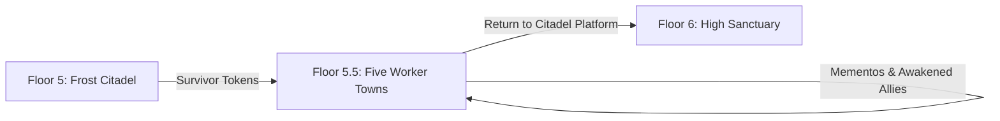

# Floor 5.5 — The Five Worker Towns (Salt Reach, Glassbank, Woolcross, Greenrest, Brass Yard)

Living design document for **Floor 5.5** of Layla: the five optional worker towns unlocked after defending the courtyard on Floor 5.

Between the heavy battle at the Frost Citadel (Floor 5) and sneaking alone into the High Sanctuary (Floor 6), Layla gets a chance to step away from the fighting. She can visit the real towns where the people she saved actually live. This break gives the player a chance to explore, meet families, recruit new companions, and take on side quests about missing loved ones whose memories live on in special **memento** items.

> [!IMPORTANT]
> **Writing Guide for Floor 5.5:**
> All player-facing text must use **simple sentences and everyday words for teenagers**. Avoid fancy, archaic, or textbook words:
> - Say **town**, not *settlement* or *municipality*.
> - Say **clock**, not *chronometer* or *horological instrument*.
> - Say **crab monster**, not *crustacean construct*.
> - Say **broken glass**, not *cullet* or *vitric debris*.
> - Say **mushroom scout**, not *mycologist*.
> - Say **cannot take back**, not *irrevocable*.
> - Say **glowing**, not *bioluminescent*.
> - Say **steep**, not *precipitous*.

---

## 1. Story & Setting: The Real People Behind the Monsters

### The Break Between Floors 5 and 6
On Floor 5, Layla saved five workers locked in cages while rival noble houses attacked the castle. On Floor 6, she will learn a dark secret: the dungeon is a giant factory that takes normal workers, separates their spirits into soul containers, wipes their memories, and binds them into monsters, workers, and utility guardians placed across the kingdom and the lower floors.

**Floor 5.5 connects those two parts of the story.**

Before Layla sees the factory on Floor 6, she visits the five towns where those workers came from:
- These are hard-working company towns. Each town does one job to supply the mountain castle: harvesting salt, blowing glass, weaving wool, growing medicine, or fixing steam machines.
- The people here know that their friends, brothers, sisters, and parents disappear during **the cull**. They have been told for years that the mountain demands these sacrifices.
- In each town, Layla meets the families left behind. She sees what the dungeon steals: warm homes, family meals, shared tools, and memories of the people they love.



### Where These Towns Sit in the Machine
The cull runs one step ahead of Layla the whole time.

- The five workers Layla freed from the cages on Floor 5 were **waiting** for the machine. They were counted, boxed, and queued, but not yet processed.
- The five people missing from these towns were taken in an earlier cull. They are **already through** the machine. That is why the family member Layla is hunting is not in a cell — it is standing in the town's own outskirts, wearing a shell the Citadel built around them.
- So the dungeon takes two people from one family. One is gone, one is barely saved. Floor 5.5 is where Layla learns that the monsters she has been fighting all game used to eat at these tables.

This is the quiet horror the player carries into Floor 6: every beast in the kingdom came from a town like these.

### The Six Worker Towns
Six worker towns exist below the mountain fortress. Town 04 (**Deepwell**) is the mining town Layla already explored on Floor 4 with Zayd, Rashid, and Jamil. The other five towns make up Floor 5.5:

| Block | Town Name | Work | Rescued Friend from Floor 5 |
|---|---|---|---|
| **Block 01** | **Salt Reach** | Salt pans & cold-sea fishing | **Nivi Olsen** (Supply Clerk) |
| **Block 02** | **Glassbank** | Glass kilns & colored signal lamps | **Eliška Nováková** (Signal Tester) |
| **Block 03** | **Woolcross** | Mountain wool & climbing ropes | **Amaru Quispe** (Loom Mechanic) |
| *Block 04* | *Deepwell* | *Ore mines & steam boilers* | *(Zayd, Jamil — Floor 4)* |
| **Block 05** | **Greenrest** | Warm cave gardens & healing herbs | **Abeni Adeyemi** (Grower) |
| **Block 06** | **Brass Yard** | Clocks, pumps, cranes & gears | **Chen Yu-xin** (Machinist) |

> [!NOTE]
> If a captive died during the Floor 5 siege, their town was never unlocked for that playthrough. That town stays locked, and its quest, memento, and monster cannot be found. Saving everyone on Floor 5 gives the player access to all five towns.

---

## 2. The Heart of the Floor: Grief, and One Memory the Machine Could Not Erase

Floor 5.5 is not a loot stop. It is the emotional floor — the one that turns the dungeon's monsters back into people in the player's mind before Floor 6 states the fact outright.

### The One Thing the Wipe Cannot Reach
The machine is good at erasing. It strips names, faces, and years. But it cannot erase a habit of love that was worn into a person over decades — the exact way one person made tea for another, the weight of a tool that only fit one pair of hands, a joke that only one family understood.

On Floor 4 this was Zayd's lantern: the one warm thing the conversion works could not put out. Every town holds one more object like that. Call it a **memento**. It is not magic. It is memory that got practiced so many times it became part of the body. That is why it wakes a monster's true mind, and that is why it cannot be handed around like a spare helmet.

### Layla's Arc
Layla reads the world like a chess player reads a board: rules, spaces, counts, moves. The lower floors rewarded that. Floor 5.5 is the first place where the board looks back. Every piece on it has a name, a kitchen table, and someone still setting a place for them.

She does not say any of this out loud. It shows in behavior — she slows to let the heavy stone feet keep up; she walks the extra mile to carry a stranger's story home. When she reaches Floor 6 and sees the spirits queued for wiping, she already knows what she is looking at.

### The Recurring Motif: The Tally
Every town keeps a list of the people it lost, and every town keeps the list in the medium of its own work:

- Salt Reach scratches names into sea stone, where salt slowly smooths them away.
- Glassbank hangs a dark lamp in the guild window for each name.
- Woolcross ties a black knot into a telling cord for each name.
- Greenrest carves names into a living memory root.
- Brass Yard engraves a brass plate for each name and lets the master clock toll once.

The towns pretend these lists are gravestones. A name on the list means the person is dead, and dead is safe to say. Anything else — *taken, changed, still walking* — is forbidden to say out loud, because saying it invites the mountain to come back for the speaker too. Clearing a name off the list, or adding it back honestly, is a quiet victory in every quest.

---

## 3. The Face of the Machine

### The Same Five Faces Run Every Town
Floor 4 already showed Layla how the machine works when you get close to it. The village under the mine was not run by monsters. It was run by people playing five parts:

| Role | In Deepwell (Floor 4) | What the role does |
|---|---|---|
| **The enforcer** | Commander Malik's garrison | Soldiers with weapons. They make sure nobody enters or leaves without permission, and they think workers can be replaced. |
| **The emissary** | Priest Harun | A calm, soft-spoken person from above who comes to collect the "offering" and calls the cull holy and good. |
| **The one who signed** | Elder Rashid | A local leader, afraid for their own family, who gives a neighbor away to protect the town. They carry the guilt for years. |
| **The one who doubts** | Tariq the clockmaker | A local who does not believe the cover story and quietly keeps the truth alive. |
| **The pressure from above** | The Handler | The voice in Layla's ear that tells her to look away: *"Let the offering ship. That's the job."* |

Every one of the five worker towns has these same five parts. The machine at the top has no face at all — that is the point. It borrows the face of whoever lives closest. So this floor never needs one big villain. It needs a captain, a collector, a frightened elder, and a doubter, five times over — each one different, each one a neighbor.

### Why These Five Were Taken
The cull does not take people at random. It takes the ones who notice too much — the careful ones who count, look, read, and remember. Each of the five missing people did one small, brave thing, and that was enough for the office above to hear it.

They were not the weak or the unlucky. They were the ones who saw, and who could not pretend they had not seen.

| Missing Person | The one thing they did |
|---|---|
| Keld Olsen | Counted the crates and found people listed as *live cargo* |
| Miloš Novák | Looked through his giant lens and saw workers' faces inside the monsters |
| Yana Quispe | Read the haul rope and learned the bucket carries offerings, not ore |
| Dayo Adeyemi | Hid the town's winter-orchid seeds before the guards came |
| Chen Ming-de | Refused to set the gate timers that would trap fleeing miners |

### Keep It a Loose Echo
These towns are inspired by real labor history — company towns, debt-farms, the great weavers' and miners' strikes, the market women who faced down a tax office. Do **not** name real people, places, or dates in the game text. Borrow only the shape: a fair wage withheld, a name erased for asking, a place where speaking up costs you everything. The player should feel the history in it without ever being taught it.

---

## 4. How a Town Story Works

### The Shared Arc
Each town follows the same seven beats so the player always knows how to move, but each town fills them with different people and a different grief:

1. **Arrive.** Layla teleports in with her party. The town square is warm and busy and ordinary, which makes the loss worse.
2. **The ask.** The rescued friend asks Layla to find a missing relative. The friend names the town's official lie ("the sea took him," "she slipped") and, quietly, admits they do not believe it.
3. **Ask around.** Layla questions townsfolk and inspects work places for clues. The town's cover story starts to crack.
4. **The complication.** One person stands in Layla's way — an elder protecting the old lie, a guild that erased a name, a child who insists on coming along. This is where the town's real relationship to the cull shows.
5. **The gate and the sigil.** The way to the memento is blocked by a barrier built from the town's own work. One sigil opens it, and a second clever path always exists. This is where the floor teaches each power before Floor 6 asks for it under pressure.
6. **The memento.** In the outskirts, Layla finds the object the missing person wore into their hands. It holds one unbroken memory.
7. **The awakening.** A monster in the outskirts is the missing person. Layla charms it, gives it the memento, and its true name and voice return. The family gets one of them back.

### One Relationship Per Town
The five losses are deliberately different, so each town hurts in a different way:

| Town | Layla's Guide | Missing Person | Relationship | Grief Shape |
|---|---|---|---|---|
| Salt Reach | Nivi Olsen | Keld Olsen | Older brother | Denial — she will not say his name |
| Glassbank | Eliška Nováková | Miloš Novák | Uncle | Shame — the town was told he was a thief |
| Woolcross | Amaru Quispe | Yana Quispe | Older sister | Fear — he is young and wants to go himself |
| Greenrest | Abeni Adeyemi | Dayo Adeyemi | Husband | Bargaining — she saved the town's seeds, not him |
| Brass Yard | Chen Yu-xin | Chen Ming-de | Grandfather | Work — she hides grief inside a repair job |

### The Five Gates
Each town blocks the memento with a gate made from the town's own work. Every gate has one sigil that opens it and one other way through, so the player is never stuck without a specific scroll:

| Town | The gate | Sigil that opens it | The other way |
|---|---|---|---|
| Salt Reach | A huge **Ice Warden** rimeclaw asleep in the frozen arch | **Charm** | Drive it off with a fire sprite (**spawn**) |
| Glassbank | A sealed vault room swept by a deadly light beam | **Teleport** | Drain the beam's power core (**drain**) |
| Woolcross | A bridge of living knots that grabs anything that walks | **Drain** | Burn the knot loose with a fire sprite (**spawn**) |
| Greenrest | A wall of thorn-sealed roots over the orchid cave | **Spawn** | Wither the roots with a drain mark (**drain**) |
| Brass Yard | A water gate that drops before anyone can cross | **Spawn + Teleport** | Charm a steam golem to hold the valve open (**charm**) |

Salt Reach uses **charm** on purpose — it is the sigil every player already has, a warm-up before the four towns that follow teach **teleport**, **drain**, **spawn**, and finally the two-part Brass Yard gate. Each town hides a teaching scroll for its gate's sigil, so the puzzle stays solvable even if the player skipped that scroll earlier.

### What the Memento Rule Is
A memento gives its holder **+6 Wisdom**. Monsters in these towns start with low Wisdom (roughly 4–6). Reach 10 and the fog breaks — the monster remembers who it was.

> [!IMPORTANT]
> **Once Layla gives a Memento to a companion, she cannot take it back.**

In the story, this makes sense: awakening is not like swapping a helmet. The memento holds the one memory that keeps the new mind from sliding back into a blank, brainwashed daze. The awakened companion grips it with everything they have. Taking it back would rip the mind away and leave the shell again.

### Traveling With the Party
Each town has a permanent stone-and-metal **Teleport Platform** in its square, like the pad in Deepwell or the ring in the Floor 5 courtyard. When Layla registers a town with the survivor's token, that platform joins the network for good, and her whole following party travels with her.

Companions can explore the towns, guard the squares, or fight beside Layla in the outskirts. The one exception is Floor 6, which is a solo infiltration using Einar's stealth token. When Layla leaves for the High Sanctuary, her party stays behind at the Citadel, and the awakened relatives stay with them.

---

## 5. Local Monsters in the Town Outskirts

Just like the stone golems that roamed near Deepwell on Floor 4, each worker town has monsters wandering outside the main streets — in old quarries, scrap heaps, garden caves, or mountain cliffs.

### How Town Monsters Work
1. **Made from local materials.** They look like the work of the town. Salt Reach has salt-crust crabs. Glassbank has glass-shard hounds and quartz statues. Woolcross has fleece-covered moss rams. Greenrest has root-and-mushroom beasts. Brass Yard has clockwork dogs and steam golems.
2. **Neutral or territory-bound.** They do not march on the town the way the soldiers did on Floor 5. They stay in their work areas or wild outskirts, going about a job they cannot remember being given.
3. **Can be charmed.** Layla can draw a charm ring around them and add them to her party.
4. **One is the missing person.** In each town, one monster in the wild is actually the missing relative — counted, boxed, rebuilt, and set to work. Giving it the family memento breaks the shell and restores the human mind.

```mermaid
flowchart TD
    RescuedNPC[Rescued Friend in Town] -->|Gives Quest| MissingQuest[Look for the Missing Relative]
    MissingQuest -->|Find Clues in Outskirts| GetMemento[Recover Memento (+6 WIS)]
    WildArea[Explore Town Outskirts] -->|Draw a Charm Ring| CharmMonster[Charm Local Monster into Party]
    GetMemento -->|Give Memento to Charmed Monster| Awaken[Wisdom Reaches 10 -> Awakens]
    Awaken --> HumanSelf[True Name & Voice Return + Loyal Companion]
```

---

## 6. Town-by-Town Breakdown

```
                    [ FLOOR 5: FROST CITADEL ]
                                │
       ┌───────────┬────────────┼────────────┬───────────┐
       ▼           ▼            ▼            ▼           ▼
[SALT REACH] [GLASSBANK]  [WOOLCROSS]  [GREENREST] [BRASS YARD]
 (Salt/Fish)  (Glass/Lamps) (Wool/Rope)  (Gardens)   (Machines)
```

---

### Town 1: Salt Reach (Block 01 — Cold Ocean Flats)

#### Look & Feel
Salt Reach sits on flat coastal rocks where a grey sea freezes into pale blue ice. Low wooden cabins and fish racks line the shore. Wind blows dry white salt across the stones like snow. Workers in thick leather aprons chop clear ice blocks from shallow saltwater ponds to pack fish for the castle.

#### People & Customs
Salt Reach is a Kalaallit town that lives off the sea, not the mine. The families here cut salt from frozen brine, net cold-water fish, and pack it in ice for the castle kitchens. Everyone eats around one long table per street; nobody eats alone if they can help it. When someone is taken, the town does not say they died — that is a claim, and claims are dangerous. They say the person was **called up the mountain**. The pans-master scratches each called name into the sea stone by the brine pools, letting the salt slowly smooth the letters away. That blurring is the point: it is how the town lets go without ever admitting what happened.

#### Town Friend: Nivi Olsen
Nivi is the supply clerk Layla rescued from the cage. She runs the town supply shed and welcomes Layla with hot fish soup and warm dry coats. Nivi talks in lists. She has kept the whole town fed for three winters by counting what is left and never once panicking. She keeps a running tally of blankets and food on the inside of one cuff. She has not said her brother's name out loud since the night he was called up, and she is not ready to start.

#### The Missing Person: Keld Olsen
Keld is Nivi's older brother, an ice cutter. He went out onto the outer ice shelf during a storm three weeks ago and never came back. The town says the sea took him. Nivi does not believe it, but she is the only one who says so, and only when no one else is listening.

The night before he vanished, Keld told her something odd: the castle had ordered extra ice, and extra crates, and a stranger had come down from the Citadel to count the fish. Keld noticed the count did not match the number of crates. He meant to mention it. He never got the chance.

#### The Quest: "The Salt on the Ice"
1. **The ask.** Nivi asks Layla to walk the outer shelf and bring back "anything of his," so the family can have a stone and put a name on it. She hands over the harbor's spare lamp and a packed lunch she pretends is for the walk.
2. **Ask around.** On the wharf, the fishers trade rumors in low voices. An old cutter named **Aputsiaq** insists the ice does not take men that careful. In the supply shed, a crate manifest shows a line between the fish shipments: *live cargo — north*. Nivi goes quiet if Layla reads it out loud.
3. **The complication.** Aputsiaq blocks the path to the shelf. He has watched the ice for sixty winters. He knows what a storm does and what it does not, and he says the outer shelf is "where the town's luck went." Layla can reason with him, wait him out, or walk past. He will not stop her twice, but he will not forgive the town for what happens next either.
4. **The search.** Out on the ice, Layla finds Keld's sled crushed under a slab, cut ropes, and boot prints that lead up to a ledge and simply stop — no prints coming back down. In an ice crack, wrapped in seal skin, she finds the memento.
5. **The truth.** The extra crates held people. Keld counted them, and so someone came to collect him. The storm was a story the Citadel told the town to cover the sound of the door closing.

#### The Gate and the Sigil
The way onto the outer shelf is a low frozen arch of clear blue ice — and curled inside it, filling the whole gap, is a huge rimeclaw the fishers call the **Ice Warden**. It has slept there for years, and the town leaves it alone.

- **The sigil:** Draw a **charm ring** around it. The Warden wakes calm, uncurls, and lets Layla pass.
- **The other way:** Trace a **spawn** sigil to call a small fire sprite. The Warden hates fire and backs out of the arch on its own — but it remembers who carried the flame.
- **What it teaches:** This is the warm-up gate. It uses the one sigil every player already has, so the first town never stops the story.

#### The Memento: Keld's Bone Compass
- *Type:* keepsake trinket (worn on a ring or in the off hand)
- *Description:* *"A small pocket compass carved from sea bone, stained pale blue by saltwater. The needle does not point north; it points toward the nearest warm fire. The letters 'K.O.' are cut into the back."*

#### Local Monsters
- **Rimeclaw** (`salt_rimeclaw`): A four-legged crab monster made of hard rock salt and blue ice. Its salt shell turns away normal blade cuts.
- **Brine Hound** (`salt_brine_hound`): Low, quick hunting beasts formed from ocean salt and cold fog.

#### The Awakening: Keld Olsen
- **Target Monster:** The **Old Rimeclaw** (`salt_rimeclaw_alpha`), sitting quietly on the outer shelf and watching Keld's broken sled.
- **How to Charm:** Layla draws a charm ring across the nearby ice mounds to encircle it.
- **Giving the Memento:** Layla gives the bone compass to the crab. It presses the compass to its chest. The salt shell cracks open with blue light and a tall man stands up.
- *True Name:* **Keld Olsen**
- *Title:* Awakened Ice Cutter of Salt Reach
- *Waking Line:*
  > *"Nivi... is the stove still lit? They put ice in my veins and turned my hands into salt claws, but the needle still pointed home. I can hold an axe again."*
- *Combat Style:* Tough defender with high health and cold resistance.

#### The Reunion & What Layla Learns
Nivi does not run to him. She names everyone else on the street first, one by one, to steady herself — and then, finally, her brother. Then she takes the tally stone down to the water and lets the sea stone smooth his name away for the last time, because now there is a person to say it to instead.

What Layla learns: the crates that feed the castle and the crates that carried people are the same crates. The town's food and the town's grief ride the same sled. On Floor 5, the courtyard cages were marked with the same white codes.

---

### Town 2: Glassbank (Block 02 — Furnace Arcades)

#### Look & Feel
Glassbank is built inside a deep stone ravine kept warm by brick ovens. Tall chimneys puff orange sparks into the dark winter sky. Streets are strung with hundreds of glass lamps in deep blue, green, and gold, throwing colored pools of light over the snow. The air rings with the clink of metal blowpipes and the crack of cooled glass.

#### People & Customs
Glassbank is a Czech town of furnace guilds. Families work the same bench for generations. The town is proud of one thing above all: a clean name. A grinder who cuts a true lens is honored in the guild window; a grinder who cheats is struck off and never spoken of again. When someone is taken, the guild hangs a dark glass lamp in the window for them, unlit. It is the town's way of saying *we do not know what happened, and we will not ask.* Glassbank would rather believe a lie about one of its own than admit the castle reached into the guild hall.

#### Town Friend: Eliška Nováková
Eliška is the signal tester from Floor 5. Back at her testing table, she sorts colored lenses and gives Layla heat-proof gloves. She is patient and precise, and she notices a flaw in a piece of glass before she notices a person has walked into the room. She trusts things she can measure and mistrusts everything else — including, lately, her own memory of her uncle.

#### The Missing Person: Miloš Novák
Miloš is Eliška's uncle and the town's best lens grinder. The Citadel ordered him to build giant spyglass lenses for the castle towers. When he looked through them, he saw something he was not meant to: the monsters down in the lower valley were wearing workers' clothes, and some of the faces still looked like faces. Two nights later, white guards came for him.

To explain the arrest, the guild was told Miloš had robbed the guild funds and fled. The town erased his name from the guild window. Eliška has half-believed the shame story for months, because the alternative is worse.

#### The Quest: "The Flaw in the Glass"
1. **The ask.** Eliška asks Layla to search her uncle's shop, which the guild locked and left untouched out of superstition. She wants a keepsake, and, though she will not say it, she wants to know whether the thief story is true.
2. **Ask around.** On Opticians' Row, the guildmaster **Mistr Kučera** repeats the theft story with a practiced, tired voice. A younger grinder whispers that the guild books never showed anything missing. The window's dark lamp for Miloš has been polished recently — someone still tends it.
3. **The complication.** Mistr Kučera does not want the shop opened. Reopening it means reopening the question of Miloš's name, and the guild has spent months deciding the matter is closed. Layla must choose how hard to push, and whether to bear the truth back to the whole guild or just to Eliška.
4. **The search.** In Miloš's locked shop, Layla finds his notebook and a velvet box hidden inside a brick chimney flue. The notebook is full of careful lens diagrams — and, on the last page, a sketch of a worker's face reflected in a polished lens, with one word beside it: *"people."*
5. **The truth.** Miloš never stole anything. He saw the truth through his own glass, and the truth got him removed. The theft story exists to keep the town from asking what he saw.

#### The Gate and the Sigil
Miloš's hidden shop vault sits behind a room the guild sealed long ago. A single beam of focused light sweeps the room from a lens high in the wall — slow enough to count, and bright enough to cut stone.

- **The sigil:** Draw a **teleport** sigil to blink across the room between sweeps, the way Layla crossed the barred gate on Floor 4.
- **The other way:** Find the lens's power core and **drain** it to kill the beam, then walk straight through.
- **What it teaches:** Timing and line of sight. The guild keeps a **teleport scroll** in its safe as the gate's teaching copy.

#### The Memento: Miloš's Blue Glass Monocle
- *Type:* keepsake trinket (worn on a ring or in the off hand)
- *Description:* *"A folding pocket lens framed in dark steel, with layered blue and gold glass. When you look through it, you can spot hidden cracks, weak spots, and fake illusions in anything."*

#### Local Monsters
- **Glass Hound** (`glass_hound`): Fast hunting beasts made of dark amber bottle glass. Their paws click sharply on the stones.
- **Prism Guard** (`glass_prism_guard`): Tall statues built from blue glass slabs and wire. They bounce magic and arrows off their flat faces.

#### The Awakening: Miloš Novák
- **Target Monster:** The **Blue Prism Guard** (`glass_prism_guard_lead`), standing motionless near the edge of the broken glass pit, staring up at the castle towers.
- **How to Charm:** Layla draws a charm ring around the pit rim to encircle the construct.
- **Giving the Memento:** Layla gives the monocle to the statue. It raises the lens to its blank face. The cracks on its head heal smooth, and warm light glows behind its eyes.
- *True Name:* **Miloš Novák**
- *Title:* Master Lens Maker of Glassbank
- *Waking Line:*
  > *"Eliška... I saw through their glass. They made me hollow and clear so the fire wouldn't hurt me, but I didn't forget how to shape a lens. The Citadel's light is crooked, Layla. Let me help you break it."*
- *Combat Style:* Ranged attacker that spots enemy weak points and reflects magic.

#### The Reunion & What Layla Learns
Eliška gets her uncle's name back. She relights the dark lamp in the guild window herself, in front of the guild, and dares anyone to take it down.

What Layla learns: the castle's light is a network of lenses and signal lamps, and the same guild that makes the town proud also makes the instruments that spy on it. The guards on Floor 5 used a brass spyglass; the courtyard searchlights are this town's craft. And Miloš's warning — *the light is crooked* — is the first hint that Floor 6 hides its truth behind illusions.

---

### Town 3: Woolcross (Block 03 — Mountain Loom Terraces)

#### Look & Feel
Woolcross clings to the side of a steep rocky mountain. Stone houses sit on high steps linked by wooden stairs and rope suspension bridges. Huge wooden looms clack in rhythm across open courtyards. Long banners of mountain cloth — deep blue, bright red, and warm yellow — dry in the wind. Long-haired mountain sheep and alpacas graze along narrow cliff paths above the clouds.

#### People & Customs
Woolcross is a Quechua town bound to the mountain and to the loom. Weaving is the town's memory: every family's patterns carry its history, and the town keeps a **telling cord** — a black cord with one knot tied for each person called up the mountain. The cord hangs in the loom court where everyone can see it but no one touches it. The town's worst fear is not the cull. It is the fall — a climber going off the cliff and being *gone*, the body never found, the knot tied anyway. That fear is exactly what the Citadel exploits.

#### Town Friend: Amaru Quispe
Amaru is the young loom mechanic from Floor 5 — hardly more than a boy, frightened but stubborn. He fixes treadle boards in the square and gives Layla warm dried fruit and thick wool socks. He spent the whole siege on Floor 5 trying to shield the other captives with his own body, and he has come home to find out that while he was gone, his family lost someone too. He wants to go up the crags himself. He should not.

#### The Missing Person: Yana Quispe
Yana is Amaru's older sister and the town's best cliff climber. She went into the high fog to gather silver moss for fine robes, and she never came back. Her half-woven climbing belt is still on the loom where she left it. The town says she lost her footing. Amaru has heard the fall story so many times he almost believes it, except for one detail that never sat right: Yana did not fall. She was the one who taught the whole town how not to.

#### The Quest: "The Broken Thread"
1. **The ask.** Amaru asks Layla to find out what really happened to Yana, and to promise that if she finds anything, she will tell him first — not the elders.
2. **Ask around.** Amaru says the cliff herds have been acting wild since she vanished. In the dye terraces, an old weaver named **Killa** tends the telling cord and quietly asks Layla to look at the high cableway before the elders do. Killa noticed that a rope bucket came back up empty the night Yana disappeared, and nobody logged it.
3. **The complication.** Amaru insists on coming up the crags with Layla. He is quick and knows the paths, but he is a frightened kid on a narrow ledge, and the player has to decide whether to bring him, send him home, or have a companion watch him. He will respect a firm "no" far more than a wobbly one.
4. **The search.** Up on the high crags, Layla finds an old rock slide where a rope bucket fell — and reads it backward. The bucket did not fall down the cliff. It was **hauled up**, toward the Citadel, and the cuts on the rope are clean and deliberate. Caught under the wood is the memento, wrapped safe in thick wool.
5. **The truth.** Yana did not fall. She was netted at the top of the climb, loaded into a cargo bucket, and pulled up the mountain. The town climbs on ropes it makes itself, and the same ropes hoist the offerings to the castle.

#### The Gate and the Sigil
To reach the high crag where Yana vanished, Layla must cross a rope bridge the town wove to haul sheep — but something has taken it over. The ropes have knotted themselves alive and grab at anything that steps on.

- **The sigil:** Draw a **drain** sigil along the bridge, spending its charges on the right strands, to pull the life out of the knots until the ropes fall slack and harmless.
- **The other way:** Trace **spawn** and send a fire sprite down the ropes to burn the knots loose.
- **What it teaches:** Drain removes without killing — the same complaint the town has about the cull. Killa keeps a **drain scroll** with the telling cord.

#### The Memento: Yana's Braided Spindle
- *Type:* keepsake trinket (worn on a ring or in the off hand)
- *Description:* *"A heavy wooden yarn spindle tipped with smooth copper and wound with seven cords of colored alpaca wool. When spun, it makes a quiet, steady hum that calms nervous beasts."*

#### Local Monsters
- **Moss-Ram** (`wool_moss_ram`): Big mountain beasts with curled rock horns, thick wool coats, and green moss growing on their shoulders. They charge with huge force.
- **Rope Husk** (`wool_rope_husk`): Upright figures woven from thick hemp ropes and rough wool mats, built to keep wolves away from sheep.

#### The Awakening: Yana Quispe
- **Target Monster:** The **Old Moss-Ram** (`wool_moss_ram_elder`), standing alone on the highest rock. It taps its horns gently against the cable ropes, as if trying to pull them in.
- **How to Charm:** Layla circles the narrow rock shelf with a charm ring to win the ram's trust.
- **Giving the Memento:** Layla gives the spindle to the ram. It touches the spindle with its nose. The heavy moss and stone fall away, revealing an agile mountain climber.
- *True Name:* **Yana Quispe**
- *Title:* Trail Finder of Woolcross
- *Waking Line:*
  > *"Keep tension on the warp, Amaru... If the thread snaps, the sky falls. They loaded stone onto my horns and told me to carry their walls, but I knew the rhythm of the spindle. Give me a rope; we're taking the high path."*
- *Combat Style:* Fast scout and heavy charging striker.

#### The Reunion & What Layla Learns
Amaru does not cry in front of Layla. He hands his sister the half-woven belt she left on the loom and tells her she owes him the rest of the pattern. Killa ties a second knot in the telling cord — not for the dead, but to mark the day one came back — and the town begins, slowly, to say the word *taken* out loud.

What Layla learns: the town supplied the instrument of its own grief. The climbing rope that Woolcross is proudest of is the rope the Citadel uses to haul offerings up the cliff. There is no accident here. There is a schedule, and the town was never told it.

---

### Town 4: Greenrest (Block 05 — Warm Garden Caverns)

#### Look & Feel
Greenrest is hidden inside a warm underground cave heated by hot springs. The air smells like wet soil, mint, and wood smoke. Glowing green mushrooms cover the high stone ceiling like stars, shining light on garden beds of healing plants, cabbages, and giant umbrella mushrooms. Small stone canals carry clean warm water between cave homes.

#### People & Customs
Greenrest is a Yoruba town that grows medicine in the dark. Its keepers of history carve the town's memory into a living **memory root**, a great twisted root in the market that keeps growing around every name it is given. When someone is called up the mountain, the keeper carves the name into the root and says the words for a safe journey north. The town believes the root keeps the person safe somewhere above. The town is also the kingdom's pharmacy: the herbs grown here leave in bundles for the Sanctuary apothecaries, and everyone is proud of that — nobody has yet asked what the Sanctuary does with them.

#### Town Friend: Abeni Adeyemi
Abeni is the healer and gardener from Floor 5. Back at her soil beds, she mixes herbal pastes for wounded neighbors and offers Layla fresh mint tea that restores MP. She is warm, practical, and hard to rattle — the kind of person who keeps working while she decides how to feel. She loves her town, and she is angrier at it than she lets on, because the town gave up on her husband faster than she did.

#### The Missing Person: Dayo Adeyemi
Dayo is Abeni's husband and the head mushroom scout who mapped the deep tunnels. When the castle guards came, Dayo hid the town's secret winter-orchid seeds in the wild caves before the guards dragged him into the dark. The town has decided he simply went down the deep tunnels one day and never came out — a scout's death, an honorable one, no need to ask more. Abeni thinks a man who hid the town's future before he was taken was not planning to die in a tunnel.

#### The Quest: "Seeds Under Stone"
1. **The ask.** Abeni asks Layla to search the deep tunnels for Dayo's carved water gourd — and for the seeds, which the town needs to get through winter. She admits she wants to know which one Layla finds first, and hates herself a little for it.
2. **Ask around.** In the medicine sheds, the keeper **Baba Femi** tends the memory root and is uneasy. He carved Dayo's name the same week Dayo vanished, and he now thinks he rushed it. On the root, near Dayo's name, someone has carved a small mark that is not a name — a direction, pointing deeper.
3. **The complication.** Baba Femi does not want Layla going deep. The wild caves flood, and they eat the careless. More quietly, he is afraid of what she will find, because if Dayo is alive up there, then every name the town has carved is a lie it told itself, and the root is full of them.
4. **The search.** In the wild mushroom caves, Layla cuts through a thicket of thorns and follows a trail of Dayo's carved root-marks deeper. The marks are a map — and a message. He knew the guards were coming. He hid the seeds, and the last mark, scratched deep and urgent, says: *"Do not come for me."*
5. **The truth.** Dayo was taken, and he knew it, and he spent his last free hour making sure the town would not starve without him. He was not lost. He was caught, and he tried to spare them the search Layla has just made anyway.

#### The Gate and the Sigil
Past Dayo's carved root-marks, the orchid cave mouth is sealed by a wall of roots and thorns grown together into one living door.

- **The sigil:** Trace a **spawn** sigil and send a fire sprite through the seam. Fire is dangerous in a dry cave of healing plants, so the safe move is to burn only the seam.
- **The other way:** Draw a **drain** mark across the roots to wither them until they crumble.
- **What it teaches:** Spawn's fire is a tool with a cost. Baba Femi keeps a **spawn scroll** he never had the heart to use.

#### The Memento: Dayo's Carved Seed Gourd
- *Type:* keepsake trinket (worn on a ring or in the off hand)
- *Description:* *"A small dried gourd polished with beeswax and carved with drawings of underground root paths. Inside, three glowing purple seeds rattle softly, giving off a gentle warmth that clears headaches and confusion."*

#### Local Monsters
- **Bramble Treant** (`green_bramble_treant`): Walking tangles of thorny branches and damp peat that swing heavy root clubs.
- **Spore Husk** (`green_spore_husk`): Big round creatures of packed dirt and shelf mushrooms that puff out healing green dust when hit.

#### The Awakening: Dayo Adeyemi
- **Target Monster:** The **Old Spore Husk** (`green_spore_husk_elder`), resting deep in the wild caves over a patch of rare white flowers — the orchids, grown from the seeds he hid — shielding them from dirty drip water without knowing why.
- **How to Charm:** Layla lays charm marks in the connecting cave paths to circle the giant.
- **Giving the Memento:** Layla gives the gourd to the spore husk. It cradles the gourd against its chest. The sharp thorns wither, fresh green leaves sprout across its shoulders, and a deep, warm voice chuckles.
- *True Name:* **Dayo Adeyemi**
- *Title:* Head Mushroom Scout of Greenrest
- *Waking Line:*
  > *"The soil remembered my name before I did, Abeni. They tied roots to my ribs and told me to choke the garden, but the seeds stayed dry in the gourd. My roots answer to life now, not the Citadel."*
- *Combat Style:* Tank and group healer.

#### The Reunion & What Layla Learns
Abeni does not mention the seeds first. She tells Dayo about the winter, the neighbors, the garden. Only after he is safe does she let herself be angry that he told them not to come. Baba Femi carves a second line under Dayo's name — *returned* — and the memory root grows around both.

What Layla learns: the medicine grown here is shipped to the Sanctuary apothecaries. The same healers' trade that keeps Greenrest fed was turned, upstairs, into the remedies that calm and erase minds. On Floor 6, the herbalist who quietly brews remedies to resist that erasure is working with the same plants. The town's greatest craft and the dungeon's cruelest tool grow in the same soil.

---

### Town 5: Brass Yard (Block 06 — Steam Machine Basin)

#### Look & Feel
Brass Yard sits inside a deep stone quarry basin filled with iron boilers, steam pipes, and ticking gears. High cranes roll on steel tracks, moving big iron plates and steam pistons. The air smells of warm oil, coal smoke, and metal. Steam whistles blow shift changes, pressure pipes hiss, and long workbenches are lit by humming electric lamps.

#### People & Customs
Brass Yard is a Taiwanese town of machinists. The whole basin runs on shifts, and the master clock in the machine court rules the town: the town wakes, eats, and sleeps when it tolls. Each person the cull takes gets a brass plate on the clock's base, and the clock tolls once for the name. The town is proud of one thing — that its machines never lie. A gauge shows what is true. A clock keeps time whether you want it to or not. So Brass Yard told itself a story that no machine would ever confirm: that their best clockmaker broke his tools and ran off in shame. It was easier than the truth.

#### Town Friend: Chen Yu-xin
Yu-xin is the young machinist from Floor 5, sixteen and already the best hand at the bench. She files brass keys, checks valves, and fixes armor for Layla's party for free — and she is proud of it. She speaks rarely, letting her work talk. Since she came home, she has taken a broken clock apart and put it back together four times without ever saying why. Grief, for Yu-xin, is a repair job she cannot finish.

#### The Missing Person: Chen Ming-de
Ming-de (陳明德) is Yu-xin's grandfather and the town's master clockmaker. He built the timer clocks for the mountain water gates. The Citadel ordered him to set those timers so that fleeing miners — the ones running from the deep mines on Floor 4 — would be caught when the gates dropped. Ming-de refused. Castle guards broke into his shop and took him away. The guild, told to explain the disappearance, spread the story that he broke his own tools and left in shame. Yu-xin has never believed it, because her grandfather's tools were never broken. They were missing.

#### The Quest: "Grandpa's Broken Clock"
1. **The ask.** Yu-xin frames the whole thing as a job. She says her grandfather "left a clock half-finished" and asks Layla to help her find the missing piece — though the missing piece is her grandfather, and they both know it.
2. **Ask around.** In the gear pits, the shift foreman **Lin Bo** parrots the shame story, but his hands are stained with the same clock oil as Yu-xin's, and he will not meet her eye. On the master clock's base, Ming-de's brass plate has been pried off and hastily re-screwed, crooked.
3. **The complication.** The town would rather not touch this. Reopening Ming-de's case means admitting the guards came in the night, which means admitting the castle can reach into the machine court. Lin Bo blocks the search of the scrap heap for the town's sake, and Yu-xin has to decide whether to fight him or go around him.
4. **The search.** Searching the scrap heaps, Layla finds Ming-de's heavy tool chest buried under rusted gear casings. Every tool in it is clean, oiled, and whole. The shame story cannot survive that. Inside the chest, ticking softly, is the memento.
5. **The truth.** Ming-de never ran and never broke a thing. He refused to set a timer that would trap miners, and the castle took him for it. His tools are intact because a man who broke his tools would have broken *something*, and he broke only his orders.

#### The Gate and the Sigil
The scrap heap where Ming-de's tool chest lies sits behind the basin's old water gate — a heavy sluice that opens on the shift whistle and slams shut a few breaths later, flooding the channel.

- **The sigil:** This gate needs two things at once. Trace **spawn** to call two fire sprites and set them on the two valve wheels, then trace **teleport** to blink through while the gate is up.
- **The other way:** Charm a nearby steam golem and have it brace the valve wheel with its iron hands, then walk through with the party.
- **What it teaches:** Combining powers — the dress rehearsal for Floor 6, where Layla must slip through a guarded gate alone. Lin Bo keeps a **spawn scroll** in the foreman's shack.

#### The Memento: Grandpa Ming-de's Heartbeat Watch
- *Type:* keepsake trinket (worn on a ring or in the off hand)
- *Description:* *"A solid brass pocket watch with clear glass faces. It does not tick out normal seconds; its gears tick in time with the heartbeat of whoever holds it, pulsing with steady, stubborn life."*

#### Local Monsters
- **Clockwork Dog** (`brass_clockwork_dog`): Quick four-legged scouts made of brass gears and steel wire, digging for nuts and bolts in the scrap heaps.
- **Steam Golem** (`brass_steam_golem`): Big humanoid labor machines made of iron plates and copper rivets, puffing steam from shoulder vents.
- **Brass Overseer** (`brass_steam_overseer`): A tall overseer frame that checks the same broken steam gauge in an endless loop, as if waiting for time to move again.

#### The Awakening: Chen Ming-de
- **Target Monster:** The **Brass Overseer** (`brass_steam_overseer`), standing atop the junk heap, checking a broken steam gauge with mechanical repetition, never stopping.
- **How to Charm:** Layla lays charm marks in a circle around the scrap pile to tame the overseer.
- **Giving the Memento:** Layla gives the watch to the machine. It takes the watch, and the ticking gears lock into place with its core. Clean white steam puffs from its vents, and a warm grandfatherly voice speaks through the grill.
- *True Name:* **Chen Ming-de** (陳明德)
- *Title:* Master Clockmaker of Brass Yard
- *Waking Line:*
  > *"Check the teeth on the third gear, Yu-xin... A clock never lies about how much time has been stolen. They bolted iron to my head to turn me into a machine, but my gears still beat like a heart. Let's wind this dungeon down."*
- *Combat Style:* Smart fighter who slows enemies and vents hot steam.

#### The Reunion & What Layla Learns
Yu-xin does not make a speech. She hands her grandfather his cleaned tools, one at a time, and he checks each one the way he always did. Then she fixes his brass plate back onto the master clock, straight this time. The town hears the clock toll for a name and, for once, understands it means the name is alive.

What Layla learns: the water-gate timers that trap fleeing miners are the machine side of the cull — the part that makes sure nobody runs. Time here is the instrument of the trap; Ming-de's watch beats like a heart against the clock's cold count. And the gates he refused to set are the same system Layla will have to disable to open the way down on Floor 6.

---

## 7. The Five Names (Payoff on Floor 6)

The emotions planted in the towns are collected in Floor 6's soul vaults.

In the binding ledger beneath the High Sanctuary, converted people are listed the way a shipping clerk lists goods: name, town, trade, and the shell their spirit was bound into. Higher on the same page are older entries the player has already met — **Jamil of Deepwell**, bound into a guardian golem and woken by Zayd's lantern; **Nazira**, bound into an elf queen and woken by her son's voice.

Lower on the page are the five the player will recognize by name if they did the town quests:

| Name | Town | Trade | Bound Shell | If Layla Awakened Them |
|---|---|---|---|---|
| **Keld Olsen** | Salt Reach | Ice cutter | Rimeclaw | the entry is struck through and marked *reclaimed* |
| **Miloš Novák** | Glassbank | Lens maker | Prism Guard | the entry is struck through and marked *reclaimed* |
| **Yana Quispe** | Woolcross | Climber | Moss-Ram | the entry is struck through and marked *reclaimed* |
| **Dayo Adeyemi** | Greenrest | Mushroom scout | Spore Husk | the entry is struck through and marked *reclaimed* |
| **Chen Ming-de** | Brass Yard | Clockmaker | Steam Overseer | the entry is struck through and marked *reclaimed* |

The player who skipped a town, or lost that town's worker on Floor 5, sees the name sitting there unmarked — just one more bound shell, one more piece of stock. There is no scolding and no scoreboard. The ledger simply reads the truth, and Layla has already learned how much that costs.

This is also where the game says out loud what the five towns said in small ways: every monster in the kingdom was a person, and this page is the proof.

---

## 8. Verification Goals

These are the design checks that must hold when the floor is built. They confirm the rules in prose form; exact content ids and code live with the implementation, not in this plan.

1. **Party travel.** With Astrid and Einar in Layla's party, teleporting into a town square brings them along. Companions can explore, guard, and fight in the town.
2. **Memento is permanent.** Once Layla gives a memento to a companion, she cannot take it back. The command is refused with a clear line about the awakened mind, and the companion keeps the item.
3. **Awakening at Wisdom 10.** A charmed town monster starts with low Wisdom. Giving it the matching memento raises Wisdom to 10 or higher, which wakes it: its true name, title, and voice return, and it becomes a loyal companion.
4. **Floor 6 stays solo.** When Layla consumes the stealth token to enter the High Sanctuary, her party — including the awakened relatives — remains behind at the Citadel, preserving Floor 6's solo infiltration.
5. **Every gate has two ways.** Each town gate opens with its headline sigil and with the alternate path. A player who lacks one scroll is never stuck, and the gate still teaches the sigil it was built around.
