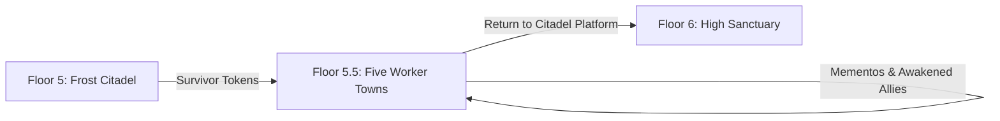

# Floor 5.5 — The Five Worker Towns (Salt Reach, Glassbank, Woolcross, Greenrest, Brass Yard)

Living design document for **Floor 5.5** of Layla: the five optional worker towns unlocked after defending the courtyard on Floor 5.

Between the heavy battle at the Frost Citadel (Floor 5) and sneaking alone into the High Sanctuary (Floor 6), Layla gets a chance to step away from the fighting. She can visit the real towns where the people she saved actually live. This break gives the player a chance to explore, meet families, recruit new companions, and take on side quests about missing loved ones whose memories live on in special **memento** items.

> [!IMPORTANT]
> **Writing Guide for Floor 5.5:**
> All player-facing text must use **simple sentences and everyday words for teenagers**. Avoid fancy, archaic, or textbook words:
> - Say **town**, not *settlement* or *municipality*.
> - Say **clock**, not *chronometer* or *horological instrument*.
> - Say **crab monster**, not *crustacean construct*.
> - Say **broken glass**, not *cullet* or *vitric debris*.
> - Say **mushroom scout**, not *mycologist*.
> - Say **cannot take back**, not *irrevocable*.
> - Say **glowing**, not *bioluminescent*.
> - Say **steep**, not *precipitous*.

---

## 1. Story & Setting: The Real People Behind the Monsters

### The Break Between Floors 5 and 6
On Floor 5, Layla saved five workers locked in cages while rival noble houses attacked the castle. On Floor 6, she will learn a dark secret: the dungeon is a giant factory that takes normal workers, wipes their memories, and turns them into monsters for the lower floors.

**Floor 5.5 connects those two parts of the story.**

Before Layla sees the factory on Floor 6, she visits the five towns where those workers came from:
- These are hard-working company towns. Each town does one specific job to supply the mountain castle: harvesting salt, blowing glass, weaving wool, growing medicine, or fixing steam machines.
- The people here know that their friends, brothers, sisters, and parents disappear during "the cull." They have been told for years that the mountain demands these sacrifices.
- In each town, Layla meets the families left behind. She sees what the dungeon steals: warm homes, family meals, shared tools, and memories of the people they love.



### The Six Worker Towns
Six worker towns exist below the mountain fortress. Town 04 (**Deepwell**) is the mining town Layla already explored on Floor 4 with Zayd, Rashid, and Jamil. The other five towns make up Floor 5.5:

| Block | Town Name | Work | Rescued Friend from Floor 5 | Transit Token |
|---|---|---|---|---|
| **Block 01** | **Salt Reach** | Salt pans & cold-sea fish | **Nivi Olsen** (Supply Clerk) | `salt-reach-transit-seal` |
| **Block 02** | **Glassbank** | Glass kilns & colored signal lamps | **Eliška Nováková** (Signal Tester) | `glassbank-transit-prism` |
| **Block 03** | **Woolcross** | Mountain wool & climbing ropes | **Amaru Quispe** (Loom Mechanic) | `woolcross-transit-knot` |
| *Block 04* | *Deepwell* | *Ore mines & steam boilers* | *(Zayd, Jamil — Floor 4)* | *Platform anchor* |
| **Block 05** | **Greenrest** | Warm cave gardens & healing herbs | **Abeni Adeyemi** (Grower) | `greenrest-transit-seed` |
| **Block 06** | **Brass Yard** | Clocks, pumps, cranes & gears | **Chen Yu-xin** (Machinist) | `brass-yard-transit-seal` |

> [!NOTE]
> If a captive died during the Floor 5 siege, their town token was lost for that playthrough. That town stays locked, and its quest, memento, and monster cannot be found. Saving everyone on Floor 5 gives the player access to all five towns.

---

## 2. Core Mechanics: Platforms, Mementos, and Awakening

### 2.1 Permanent Teleport Platforms in Every Town
In Cinder, small chalk marks or single-use tokens only move a single person. To move a whole group together, you need a heavy, permanent teleport platform (like the stone platform in Deepwell or the central ring in the Floor 5 courtyard).

To explain why Astrid, Einar, Sakhra, and Layla's other followers can travel with her to each town:
- **Every town square features a permanent stone-and-metal Teleport Platform.**
- When Layla uses a survivor's token at the courtyard platform, that town's platform lights up and connects permanently to the network.
- When Layla steps onto the platform and teleports, her entire following party travels with her.
- Companions can freely explore the towns, guard town squares, or fight beside Layla in the outskirts.
- *(Note: Once Layla enters Floor 6, that mission is a solo infiltration using Einar's stealth token, leaving her party behind at the Citadel).*

### 2.2 The Memento System
On Floor 4, Layla found `zayd-lantern`, a battered lantern that held the warm memory of Zayd's parents. Giving that lantern to Sakhra granted **+6 Wisdom**, pushing Sakhra's wisdom to 10 or higher and waking up Jamil.

On Floor 5.5, each of the five worker towns has a similar side quest:
- A family member or friend is missing.
- Layla tracks down what happened to them and recovers a special **Memento** item.
- Each memento is a personal everyday object—a compass, a magnifying lens, a wooden spindle, a seed gourd, or a pocket watch.
- Each memento grants **+6 Wisdom** when held or equipped by a monster (`trinket`, fits in `ring` or `off-hand`).
- Monsters in these towns start with 4 to 6 Wisdom. Holding a memento raises their Wisdom to 10 or higher, which triggers their **Awakening**.

### 2.3 The Rule: You Cannot Take a Memento Back
We must prevent an exploit where a player gives one memento to a monster, wakes them up, takes it back, and repeats the trick to wake up every monster in the game for free:

> [!IMPORTANT]
> **Once Layla gives a Memento to a companion, she cannot take it back.**

#### Why this makes sense in the story:
Awakening is not like swapping a helmet or a sword. The memento holds the specific human memory that keeps the monster's mind from slipping back into a blank, brainwashed daze. The awakened companion holds onto the item with all their strength. Taking it back would rip away their mind and turn them back into a mindless shell.

#### How the game enforces it:
1. Memento items have a flag in `items.json`: `"memento": true`.
2. When the player types `take <item> from <companion>`:
   - If `item.memento` is true, the game stops the action and prints:
     > *"The {item} is tied to {companion}'s heart. Taking it back would tear away their awakened mind."*
3. Giving a memento remains normal: `give <item> to <companion>`. The companion automatically equips it, their Wisdom goes up by 6, and their true name and voice return.

---

## 3. Local Monsters in the Town Outskirts

Just like the stone golems that roamed near Deepwell on Floor 4, each worker town has monsters wandering outside the main streets—in old quarries, scrap heaps, garden caves, or mountain cliffs.

### How town monsters work:
1. **Made from local materials:** They look like the work of the town. Salt Reach has salt-crust crabs. Glassbank has glass-shard hounds and quartz statues. Woolcross has fleece-covered moss rams. Greenrest has root-and-mushroom beasts. Brass Yard has clockwork dogs and steam golems.
2. **Neutral or territory-bound:** They do not march to attack the town like the soldiers in Floor 5. They stay in their work areas or wild outskirts.
3. **Can be charmed:** Layla can use `charm-sigil` to encircle them and add them to her party.
4. **One is the missing person:** In each town, one specific monster in the wild area is actually the missing family member. The Citadel captured them, partly rebuilt them into a monster, and put them to work. Giving them their family memento breaks the curse and restores their human mind.

```mermaid
flowchart TD
    RescuedNPC[Rescued Friend in Town] -->|Gives Quest| MissingQuest[Look for Missing Friend or Relative]
    MissingQuest -->|Find Clues in Outskirts| GetMemento[Recover Memento (+6 WIS)]
    WildArea[Explore Town Outskirts] -->|Encircle with Charm Sigil| CharmMonster[Charm Local Monster into Party]
    GetMemento -->|Give Memento to Charmed Monster| Awaken[Wisdom Reaches 10 -> Awakens!]
    Awaken --> HumanSelf[Human Name & Voice Return + Loyal Companion]
```

---

## 4. Town-by-Town Breakdown

```
                    [ FLOOR 5: FROST CITADEL ]
                                │
       ┌───────────┬────────────┼────────────┬───────────┐
       ▼           ▼            ▼            ▼           ▼
[SALT REACH] [GLASSBANK]  [WOOLCROSS]  [GREENREST] [BRASS YARD]
 (Salt/Fish)  (Glass/Lamps) (Wool/Rope)  (Gardens)   (Machines)
```

---

### Town 1: Salt Reach (Block 01 — Cold Ocean Flats)

#### 1. Look & Feel
Salt Reach sits on flat coastal rocks where a grey sea freezes into pale blue ice. Low wooden cabins and fish racks line the shore. Wind blows dry white salt across the stones like snow. Workers in thick leather aprons chop clear ice blocks from shallow saltwater ponds to pack fish for the castle.

#### 2. Town Friend
- **Nivi Olsen** — The supply clerk Layla rescued from the cage. Nivi runs the town supply shed and welcomes Layla with hot fish soup and warm dry coats.

#### 3. Map (4 Rooms)
1. `salt_reach_square` — **Salt Reach Landing**: The town square. Sled tracks meet here near the big stone **Teleport Platform** and supply sheds.
2. `salt_reach_pans` — **The Frozen Brine Pans**: Flat saltwater ponds cut into shore rock. Men and women cut neat salt blocks under grey mist.
3. `salt_reach_shanties` — **Fishers' Wharf**: Wooden docks where iceboats rest. Smoked fish hang under low roof eaves.
4. `salt_reach_shelf` — **Outer Ice Shelf**: A wild shelf of sea ice that groans against the cliffs. Cold wind howls, and ice creatures roam the ridges.

#### 4. Side Quest: "The Salt on the Ice"
- **The Missing Person:** **Keld Olsen**, Nivi's older brother. He was an ice cutter who went out onto the outer ice shelf during a storm three weeks ago and never came back. The town thought he drowned.
- **The Search:** Layla checks the docks. Fishers tell her about strange heavy tracks in the salt on the outer ice. Out on `salt_reach_shelf`, Layla finds Keld's crushed sled and a seal-skin pouch caught in an ice crack.
- **The Memento Item:** **Keld's Bone Compass** (`keld-compass`)
  - *Type:* `trinket` (`off-hand` or `ring`)
  - *Bonus:* `wisdom: 6`, `memento: true`
  - *Description:* *"A small pocket compass carved from sea bone, stained pale blue by saltwater. The needle does not point north; it points toward the nearest warm fire. The letters 'K.O.' are cut into the back."*

#### 5. Local Monsters
- **Rimeclaw** (`salt_rimeclaw`): A four-legged crab monster made of hard rock salt and blue ice. Its salt shell turns away normal blade cuts.
- **Brine Hound** (`salt_brine_hound`): Low, quick hunting beasts formed from ocean salt and cold fog.

#### 6. The Awakening: Keld Olsen
- **Target Monster:** The **Old Rimeclaw** (`salt_rimeclaw_alpha`) sitting quietly on `salt_reach_shelf`, watching Keld's broken sled.
- **How to Charm:** Layla circles it with `charm-sigil` across the nearby ice mounds.
- **Giving the Memento:** Layla runs `give keld-compass to rimeclaw`. The crab presses the bone compass to its chest. The salt shell cracks open with blue light, and a tall man stands up:
  - *True Name:* **Keld Olsen**
  - *Title:* Awakened Ice Cutter of Salt Reach
  - *Waking Line:*
    > *"Nivi... is the stove still lit? They put ice in my veins and turned my hands into salt claws, but the needle still pointed home. I can hold an axe again."*
  - *Combat Style:* Tough defender with high health and cold resistance (`skills: ["strike", "guard", "salt_harden"]`).

---

### Town 2: Glassbank (Block 02 — Furnace Arcades)

#### 1. Look & Feel
Glassbank is built inside a deep stone ravine kept warm by brick ovens. Tall chimneys puff orange sparks into the dark winter sky. Streets are strung with hundreds of glass lamps in deep blue, green, and gold, throwing colored pools of light over the snow. The air rings with the clinking of metal blowpipes and the crack of cooled glass.

#### 2. Town Friend
- **Eliška Nováková** — The signal tester from Floor 5. Back at her testing table, Eliška tests colored lenses and gives Layla heat-proof gloves.

#### 3. Map (4 Rooms)
1. `glassbank_square` — **Furnace Square**: A stone square lit by open kiln doors and hanging lanterns. The blue stone **Teleport Platform** rests in the center.
2. `glassbank_kilns` — **The Great Kilns**: Huge brick arches where hot melted glass is poured into molds.
3. `glassbank_optics` — **Opticians' Row**: Quiet shops where master lens makers grind lenses and cut signal mirrors for the castle towers.
4. `glassbank_cullet_pit` — **The Broken Glass Pit**: A sunken yard filled with heaps of sharp colored glass and slag. Glass creatures wander the piles.

#### 4. Side Quest: "The Flaw in the Glass"
- **The Missing Person:** **Miloš Novák**, Eliška's uncle and the town's best lens grinder. The Citadel ordered him to build giant spyglass lenses. When he looked through them, he noticed the monsters below were wearing workers' clothes. Two nights later, white guards dragged him away.
- **The Search:** Layla searches Miloš's locked shop on Opticians' Row. She finds his notebook and a velvet box hidden inside a brick chimney flue. Inside is his favorite testing lens.
- **The Memento Item:** **Miloš's Blue Glass Monocle** (`milos-monocle`)
  - *Type:* `trinket` (`off-hand` or `ring`)
  - *Bonus:* `wisdom: 6`, `memento: true`
  - *Description:* *"A folding pocket lens framed in dark steel, with layered blue and gold glass. When you look through it, you can spot hidden cracks, weak spots, and fake illusions in anything."*

#### 5. Local Monsters
- **Glass Hound** (`glass_hound`): Fast hunting beasts made of dark amber bottle glass. Their paws click sharply on the stones.
- **Prism Guard** (`glass_prism_guard`): Tall statues built from blue glass slabs and wire. They bounce magic and arrows off their flat faces.

#### 6. The Awakening: Miloš Novák
- **Target Monster:** The **Blue Prism Guard** (`glass_prism_guard_lead`) standing motionless near the edge of `glassbank_cullet_pit`, staring up at the castle towers.
- **How to Charm:** Layla traces `charm-sigil` around the glass pit rim to encircle the construct.
- **Giving the Memento:** Layla runs `give milos-monocle to prism_guard`. The statue raises the lens to its blank face. The cracks on its head heal smooth, and warm light glows behind its eyes:
  - *True Name:* **Miloš Novák**
  - *Title:* Master Lens Maker of Glassbank
  - *Waking Line:*
    > *"Eliška... I saw through their glass. They made me hollow and clear so the fire wouldn't hurt me, but I didn't forget how to shape a lens. The Citadel's light is crooked, Layla. Let me help you break it."*
  - *Combat Style:* Ranged attacker that spots enemy weak points and reflects magic (`skills: ["strike", "refract_beam", "reveal_flaw"]`).

---

### Town 3: Woolcross (Block 03 — Mountain Loom Terraces)

#### 1. Look & Feel
Woolcross clings to the side of a steep rocky mountain. Stone houses sit on high steps linked by wooden stairs and rope suspension bridges. Huge wooden looms clack in rhythm across open courtyards. Long banners of mountain cloth—deep blue, bright red, and warm yellow—dry in the wind. Long-haired mountain sheep and alpacas graze along narrow cliff paths above the clouds.

#### 2. Town Friend
- **Amaru Quispe** — The young loom mechanic from Floor 5. Amaru fixes treadle boards in the square and gives Layla warm dried fruit and thick wool socks.

#### 3. Map (4 Rooms)
1. `woolcross_square` — **Loom Court**: The town center, with four giant standing looms and the heavy copper **Teleport Platform**.
2. `woolcross_dye_vats` — **The Dye Terraces**: Stone tubs bubbling with plant dyes, moss water, and stream runoff.
3. `woolcross_cableway` — **The High Cableway**: A wooden station where rope buckets carry wood and wool across deep foggy drops.
4. `woolcross_crags` — **The High Mist Crags**: Windy cliff paths above the cloud line where wild horned beasts graze on moss.

#### 4. Side Quest: "The Broken Thread"
- **The Missing Person:** **Yana Quispe**, Amaru's older sister and the town's best cliff climber. She climbed into the high fog to gather silver moss for fine robes. She never returned, leaving her half-woven climbing belt on the loom.
- **The Search:** Amaru tells Layla that the cliff herds have been acting wild. Up on `woolcross_crags`, Layla finds an old rock slide where a rope bucket fell. Caught under the wood is Yana's wooden yarn spindle, wrapped safely in thick wool.
- **The Memento Item:** **Yana's Braided Spindle** (`yana-spindle`)
  - *Type:* `trinket` (`off-hand` or `ring`)
  - *Bonus:* `wisdom: 6`, `memento: true`
  - *Description:* *"A heavy wooden yarn spindle tipped with smooth copper and wound with seven cords of colored alpaca wool. When spun, it makes a quiet, steady hum that calms nervous beasts."*

#### 5. Local Monsters
- **Moss-Ram** (`wool_moss_ram`): Big mountain beasts with curled rock horns, thick wool coats, and green moss growing on their shoulders. They charge with huge force.
- **Rope Husk** (`wool_rope_husk`): Upright figures woven from thick hemp ropes and rough wool mats, built to keep wolves away from sheep.

#### 6. The Awakening: Yana Quispe
- **Target Monster:** The **Old Moss-Ram** (`wool_moss_ram_elder`) standing alone on the highest rock on `woolcross_crags`. It taps its horns gently against the cable ropes as if trying to pull them in.
- **How to Charm:** Layla circles the narrow rock shelf with `charm-sigil` to win the ram's trust.
- **Giving the Memento:** Layla runs `give yana-spindle to moss_ram`. The ram touches the spindle with its nose. The heavy moss and stone fall away, revealing an agile mountain climber:
  - *True Name:* **Yana Quispe**
  - *Title:* Trail Finder of Woolcross
  - *Waking Line:*
    > *"Keep tension on the warp, Amaru... If the thread snaps, the sky falls. They loaded stone onto my horns and told me to carry their walls, but I knew the rhythm of the spindle. Give me a rope; we're taking the high path."*
  - *Combat Style:* Fast scout and heavy charging striker (`skills: ["strike", "ram_charge", "sure_footing"]`).

---

### Town 4: Greenrest (Block 05 — Warm Garden Caverns)

#### 1. Look & Feel
Greenrest is hidden inside a warm underground cave heated by hot springs. The air smells like wet soil, mint, and wood smoke. Glowing green mushrooms cover the high stone ceiling like stars, shining light on garden beds of healing plants, cabbages, and giant umbrella mushrooms. Small stone canals carry clean warm water between cave homes.

#### 2. Town Friend
- **Abeni Adeyemi** — The healer and gardener from Floor 5. Happy to be back at her soil beds, Abeni mixes herbal pastes for wounded neighbors and offers Layla fresh mint tea that restores MP.

#### 3. Map (4 Rooms)
1. `greenrest_square` — **Garden Cavern**: The busy central market under glowing mushrooms, featuring the green stone **Teleport Platform**.
2. `greenrest_apothecary` — **The Medicine Sheds**: Stone drying tables where healers chop roots and mix healing salves.
3. `greenrest_springs` — **The Hot Springs**: Steaming blue water pools where tired workers rest.
4. `greenrest_spore_wilds` — **The Wild Mushroom Caves**: Overgrown cave tunnels thick with wild briars, stinging vines, and giant fungus trees where plant beasts roam.

#### 4. Side Quest: "Seeds Under Stone"
- **The Missing Person:** **Dayo Adeyemi**, Abeni's husband. He was the head mushroom scout who mapped the deep tunnels. When the castle guards came, Dayo hid the town's secret winter-orchid seeds in the wild caves before guards dragged him away into the dark.
- **The Search:** Abeni asks Layla to look in the deep tunnels of `greenrest_spore_wilds` for Dayo's carved water gourd. Layla cuts through a thicket of thorns and finds the gourd inside a hollow mushroom trunk.
- **The Memento Item:** **Dayo's Carved Seed Gourd** (`dayo-gourd`)
  - *Type:* `trinket` (`off-hand` or `ring`)
  - *Bonus:* `wisdom: 6`, `memento: true`
  - *Description:* *"A small dried gourd polished with beeswax and carved with drawings of underground root paths. Inside, three glowing purple seeds rattle softly, giving off a gentle warmth that clears headaches and confusion."*

#### 5. Local Monsters
- **Bramble Treant** (`green_bramble_treant`): Walking tangles of thorny branches and damp peat that swing heavy root clubs.
- **Spore Husk** (`green_spore_husk`): Big round creatures of packed dirt and shelf mushrooms that puff out healing green dust when hit.

#### 6. The Awakening: Dayo Adeyemi
- **Target Monster:** The **Old Spore Husk** (`green_spore_husk_elder`) resting in `greenrest_spore_wilds`. It stands over a patch of rare white flowers, shielding them from dirty drip water.
- **How to Charm:** Layla places `charm-sigil` marks in the connecting cave paths to circle the giant.
- **Giving the Memento:** Layla runs `give dayo-gourd to spore_husk`. The creature cradles the gourd against its chest. The sharp thorns wither, fresh green leaves sprout across its shoulders, and a deep, warm voice chuckles:
  - *True Name:* **Dayo Adeyemi**
  - *Title:* Head Mushroom Scout of Greenrest
  - *Waking Line:*
    > *"The soil remembered my name before I did, Abeni. They tied roots to my ribs and told me to choke the garden, but the seeds stayed dry in the gourd. My roots answer to life now, not the Citadel."*
  - *Combat Style:* Tank and group healer (`skills: ["strike", "spore_heal", "root_snare"]`).

---

### Town 5: Brass Yard (Block 06 — Steam Machine Basin)

#### 1. Look & Feel
Brass Yard sits inside a deep stone quarry basin filled with iron boilers, steam pipes, and ticking gears. High cranes roll on steel tracks, moving big iron plates and steam pistons. The air smells of warm oil, coal smoke, and metal. Steam whistles blow shift changes, pressure pipes hiss, and long workbenches are lit by humming electric lamps.

#### 2. Town Friend
- **Chen Yu-xin** — The young machinist from Floor 5. At her heavy bench vise, Yu-xin files brass keys, checks valves, and fixes armor for Layla's party for free.

#### 3. Map (4 Rooms)
1. `brass_yard_square` — **Machine Court**: The main stone yard with repair benches, rolling handcarts, and the brass-toothed **Teleport Platform**.
2. `brass_yard_pits` — **The Gear Pits**: Deep pits where workers build big steam engines and water pumps.
3. `brass_yard_manifolds` — **The Steam Pipes**: A maze of warm copper tubes, gauges, and safety valves that heat the whole basin.
4. `brass_yard_scrap_spire` — **The Scrap Heap**: A mountain of discarded brass gears, bent tubes, and old robot frames where stray clockwork figures wander.

#### 4. Side Quest: "Grandpa's Broken Clock"
- **The Missing Person:** **Chen Ming-de** (陳明德), Yu-xin's grandfather and the town's master clockmaker. He built the timer clocks for the mountain water gates. When he refused to set the timers to trap fleeing miners, castle guards broke into his shop and took him away.
- **The Search:** Yu-xin explains that her grandfather always carried a custom brass pocket watch he built himself. Searching the scrap piles in `brass_yard_scrap_spire`, Layla finds Ming-de's heavy tool chest buried under rusted gear casings. Inside sits the ticking brass watch.
- **The Memento Item:** **Grandpa Ming-de's Heartbeat Watch** (`mingde-pocket-watch`)
  - *Type:* `trinket` (`off-hand` or `ring`)
  - *Bonus:* `wisdom: 6`, `memento: true`
  - *Description:* *"A solid brass pocket watch with clear glass faces. It does not tick out normal seconds; its gears tick in time with the heartbeat of whoever holds it, pulsing with steady, stubborn life."*

#### 5. Local Monsters
- **Clockwork Dog** (`brass_clockwork_dog`): Quick four-legged scouts made of brass gears and steel wire, digging for nuts and bolts in the scrap heaps.
- **Steam Golem** (`brass_steam_golem`): Big humanoid labor machines made of iron plates and copper rivets, puffing steam from shoulder vents.

#### 6. The Awakening: Chen Ming-de
- **Target Monster:** The **Brass Overseer** (`brass_steam_overseer`) standing atop the junk heap in `brass_yard_scrap_spire`. It tirelessly checks a broken steam gauge with mechanical repetition, never stopping.
- **How to Charm:** Layla lays down `charm-sigil` marks in the circle around the scrap pile to tame the clockwork overseer.
- **Giving the Memento:** Layla runs `give mingde-pocket-watch to brass_overseer`. The machine takes the watch. The ticking gears lock into place with its core, clean white steam puffs from its vents, and a warm grandfatherly voice speaks through the grill:
  - *True Name:* **Chen Ming-de** (陳明德)
  - *Title:* Master Clockmaker of Brass Yard
  - *Waking Line:*
    > *"Check the teeth on the third gear, Yu-xin... A clock never lies about how much time has been stolen. They bolted iron to my head to turn me into a machine, but my gears still beat like a heart. Let's wind this dungeon down."*
  - *Combat Style:* Smart fighter who slows down enemies and vents hot steam (`skills: ["strike", "steam_vent", "clockwork_overclock"]`).

---

## 5. Technical Details & Code Design

### 5.1 Item Definition in `items.json`
Every memento item includes `"memento": true`:

```json
{
  "id": "mingde-pocket-watch",
  "label": "heartbeat pocket watch",
  "aliases": ["pocket watch", "watch", "heartbeat watch", "brass watch"],
  "kind": "trinket",
  "memento": true,
  "equip_slots": ["off-hand", "ring"],
  "stat_bonuses": {
    "wisdom": 6
  },
  "description": "A solid brass pocket watch that ticks in rhythm with the heartbeat of whoever holds it."
}
```

### 5.2 Blocking Take in `cinder-core`
In `cinder-core/src/engine/reducer/handlers/party.rs` (handling item transfers):
```rust
if let Some(item) = content.item(item_id) {
    if item.memento && !content.is_player_actor(from_actor_id) {
        lines.narration(format!(
            "The {} is tied to {}'s heart; taking it back would tear away their awakened mind.",
            item.label,
            state.actor_display_name(content, from_actor_id).unwrap_or(from_actor_id)
        ));
        return;
    }
}
```

### 5.3 Awakening Hook in `actors.json`
Each candidate monster has an awakening block:
```json
{
  "id": "awakening",
  "trigger": {
    "kind": "stat",
    "stat": "wisdom",
    "gte": 10
  },
  "rename": {
    "name": "Chen Ming-de",
    "who": "Master Clockmaker of Brass Yard",
    "fragment": "A clock never lies about how much time has been stolen. My gears still beat like a heart.",
    "inspect_text": "Chen Ming-de, standing proud in brass-plated clockmaker armor with keen, steady eyes."
  },
  "stance": "allied",
  "follows_player": true,
  "story_vars": {
    "chen_mingde_awakened": "true"
  },
  "narration_keys": [
    "transformation.wake.intro",
    "transformation.wake.fragment",
    "transformation.wake.reveal"
  ],
  "signals": [
    "actor_awakened:chen_mingde",
    "actor_awakened"
  ]
}
```

---

## 6. Testing Plan

1. **Party Travel via Platforms:**
   - Put Astrid and Einar in Layla's party.
   - Teleport from `courtyard_center` to `brass_yard_square`.
   - Assert Astrid and Einar arrive at `brass_yard_square` beside Layla.
2. **Memento Lock Test (`test_memento_cannot_be_taken_back`):**
   - Give `mingde-pocket-watch` to a companion.
   - Run `take heartbeat pocket watch from companion`.
   - Assert command fails, rejection narration prints, and item stays with companion.
3. **Awakening on Wisdom $\ge 10$:**
   - Charm `brass_steam_overseer` (base wisdom 5).
   - Give `mingde-pocket-watch` (+6 wisdom).
   - Assert wisdom is 11, awakening triggers, name becomes "Chen Ming-de", and speech is unlocked.
4. **Floor 6 Solo Check:**
   - Teleporting into Floor 6 leaves companions behind at the Citadel, preserving Floor 6's solo sneaking mission.
