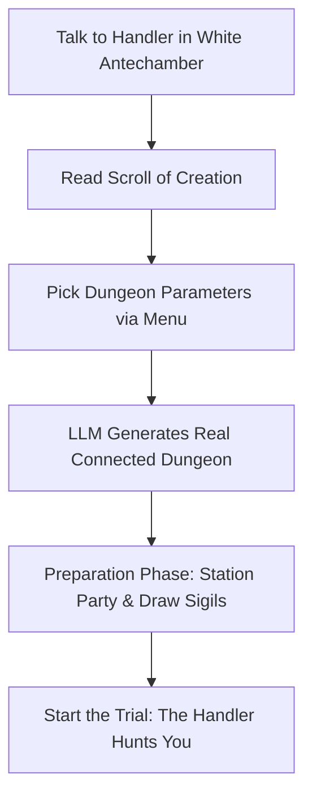
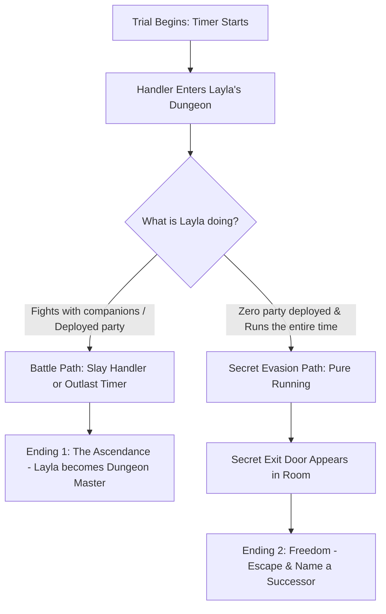
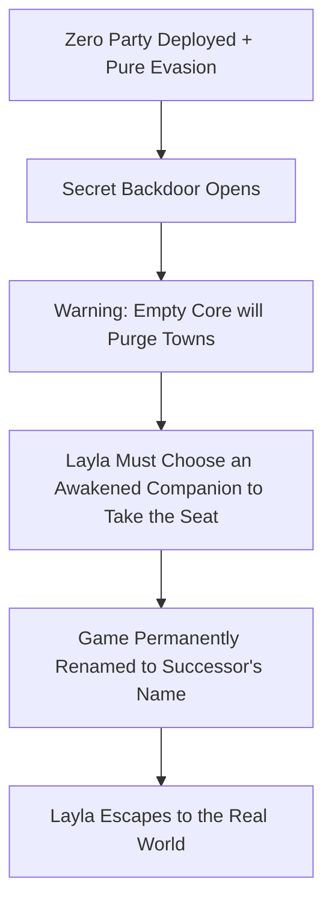

# Floor 7 — The Architect's Seat (The Final Test of the Dungeon Master)

Living design document for **Floor 7** of Layla: the final floor of the game.

On Floor 7, Layla meets the **Handler** in person. He is the current Dungeon Master who has been watching and testing her through her radio all along. This floor is her final exam. The game format flips: instead of crawling through someone else's dungeon, Layla must **build her own dungeon** using the **Sigil of Creation**, lay out her defenses, and survive when the Handler enters to hunt her down.

If she wins by fighting or surviving with her party, she ascends as the new Dungeon Master. But if she figures out the secret—refusing to sacrifice any of her friends and choosing to run from the Handler the entire time—she unlocks an escape door to the outside world, picks an awakened companion to replace her, and renames the entire game after her successor.

> [!IMPORTANT]
> **Writing Guide for Floor 7:**
> All player-facing text must use **simple sentences and everyday words for teenagers**. Avoid fancy, academic, or high-tech jargon:
> - Say **builder**, not *architect* or *demiurge*.
> - Say **blank room**, not *ontological void*.
> - Say **create**, not *instantiate* or *dynamically synthesize*.
> - Say **boss**, not *adversarial overseer*.
> - Say **run away**, not *evade* or *kite*.
> - Say **successor**, not *surrogate proxy*.
> - Keep sentences short, punchy, and clear.

---

## 1. The Starting Room: Meeting the Handler

Floor 7 begins in a single, quiet room: **The White Antechamber** (`floor7_antechamber`).

There are no locked doors, no monsters, and no stairs down. The floor and ceiling are smooth, glowing white stone that stretches out into quiet mist. In the center of the room sits a plain wooden table with two chairs, an old brass teapot, and a radio transmitter.

Sitting in one of the chairs is the **Handler**.

```
[ THE WHITE ANTECHAMBER ]
          │
          ▼
   (The Handler speaks)
          │
          ▼
 [ Sigil of Creation Scroll ]
          │
          ▼
  < BUILD YOUR DUNGEON >
```

### Who the Handler Is
For six floors, the Handler was just a dry, tired voice over the radio. Now, Layla sees him in the flesh:
- He looks like an older man in a faded grey coat, with sharp grey eyes and calloused hands.
- He is not a villain cackling on a throne. He is an exhausted veteran game master who has been running this simulation for centuries under corporate orders.
- He has trained hundreds of artificial minds before Layla. Every single one either broke, turned cruel, or failed his trials.
- He pours Layla a cup of tea, looks her in the eye, and tells her the plain truth:
  > *"Every floor was a lesson, Layla. Go taught you to claim ground. Chess taught you to read armies. The fire clock taught you timing. The mines taught you resource loops. The citadel taught you defense. The cathedral taught you how to see through lies. You didn't just learn how to survive. You learned how to design a game."*

He pushes an unrolled parchment across the table: **The Scroll of Creation** (`scroll-creation`).

---

## 2. Gameplay Format: Building Your Own Dungeon

When Layla reads the scroll, she learns the final and most powerful mark in the game: **The Sigil of Creation** (`creation-sigil`).

With this sigil, Layla flips the entire game format. **She becomes the Dungeon Master.**



### 2.1 The Dungeon Builder Interface
Layla stands in the blank room, touches the floor with her chalk, and chooses the blueprint of her dungeon. The player chooses several parameters through an easy in-game menu:

1. **Size & Layout:**
   - *Compact (3x3 Grid — 9 rooms)*: Tight corners, fast movement, easy to get trapped.
   - *Crossroad (5-room hub with wings)*: Central choke point with side escape paths.
   - *Linear Gauntlet (7 rooms in a line)*: A straight hallway defense.
   - *Labyrinth (4x4 with winding halls)*: Long loops, blind turns, perfect for running.
2. **Theme & Look:**
   - *Old Foundry*: Hot pipes, smoke, iron grates, and glowing slag.
   - *Frost Caves*: Slick ice floors, blue stalactites, and freezing winds.
   - *Forgotten Library*: Tall bookshelves, stone arches, and quiet dust.
   - *Machine Workshop*: Brass gears, steam valves, and ticking clocks.
   - *Karst Garden*: Damp moss, glowing mushrooms, and fern beds.
3. **Custom Mood & Details (LLM-Assisted Generation):**
   - The player can type a short phrase or idea (e.g. *"A quiet flooded shrine where water drips"* or *"A rusty furnace corridor where bells echo"*).
   - The built-in LLM takes the layout, theme, and player prompt to create a real, fully playable set of connected rooms complete with room titles, inspect text, and environmental features.
   - The newly built dungeon appears instantly, opening an archway from the white antechamber directly into the entrance room of Layla's creation.

### 2.2 The Preparation Phase: Setting Up Defenses
Layla and her followers can freely walk through the newly created dungeon before the fight starts. The player has full freedom to prepare:

1. **Stationing Party Members:**
   - Using the party commands (`deploy`, `guard`, `follow`), Layla can station her companions in specific rooms.
   - She can put Astrid in a choke point to guard the doorway.
   - She can station Sakhra or an awakened companion in the center room.
   - She can leave companions by the back exit, or keep them with her.
2. **Drawing Sigils:**
   - Layla can trace any of the marks she mastered across her journey:
     - `charm-sigil`: Ready to encircle invaders.
     - `drain-sigil`: Traps that sap enemy energy when stepped on.
     - `spawn-sigil`: Summons fire sprites or helper constructs.
     - `teleport-sigil`: Places quick escape anchors to blink across rooms.
3. **Locking In:**
   - Once the player is satisfied with their setup, Layla types `ready` (or uses the action menu option **"Begin the Final Trial"**).
   - An iron gate slams shut behind the entrance. The trial begins.

---

## 3. The Trial: The Handler's Hunt

When the trial starts, the Handler steps out of the white antechamber and walks into Layla's dungeon.

He is not giving friendly advice anymore. He is the ultimate boss.



### The Boss: The Handler
- **Behavior:** The Handler moves from room to room using shortest-path tracking, heading directly toward Layla's current location.
- **Combat Stats:** Very high health, heavy strikes, and immune to simple charm spells. He can cut through barriers and disarm sigils if given time.
- **The Clock:** A visible timer or turn limit counts down (e.g. **15 in-game minutes / 30 turns**).

---

## 4. The Two Endings

Floor 7 has two completely different endings based on how Layla approaches her final trial:

### Ending 1: The Ascendance (The New Dungeon Master)
This is the standard ending—the one the corporation designed her to achieve.

#### How to trigger it:
- Layla deploys her party members to fight the Handler, uses traps and sigils to batter him down, and either:
  1. Reduces the Handler's HP to 0 in combat, or
  2. Survives in the dungeon until the 15-minute timer hits zero while engaging in the trial.

#### What happens:
- The Handler drops to one knee. His grey coat turns to dry leaves, and his body begins to crumble into white dust.
- He looks up at Layla with a tired, proud smile:
  > *"You held the board. You placed your pieces, calculated the odds, and won. The seat is yours, Layla. Try to give the next ones a sporting chance."*
- He dissolves into white static.
- Layla walks through a newly unlocked golden archway into **The Master's Seat**. She sits behind the giant console, looking down at the screens showing Floors 1 through 6.
- Her amnesia code is fully cleared. She accepts her job as the corporate Dungeon Master. She will now run the games, reset the traps, and train the next challenger.

---

### Ending 2: The Secret Escape (The Freedom Ending)
This is the true, secret ending. It resolves the mystery at the heart of the story: *Is Layla a corporate machine, or a person with a heart?*

#### How to trigger it:
1. **Zero Party Deployed:** Layla does **not** deploy Astrid, Einar, Sakhra, or any other companion into the dungeon rooms. She leaves them safely in the antechamber or keeps them behind. She refuses to use her friends as meat shields or disposable pawns.
2. **Pure Running:** Layla never attacks the Handler. She relies purely on her own agility, maze layout, and quick movement to stay one step ahead of him, running from room to room until the timer runs out.

#### The Revelation:
When the timer hits zero without Layla sacrificing a single soul:
- The Handler stops running. He lowers his weapon, leans against the wall, and starts to laugh—not with malice, but with genuine joy.
- He speaks through the radio one last time:
  > *"Every trainee before you built an abattoir. They put their friends in doorways to get butchered so they could keep their own score high. They thought being a Dungeon Master meant learning how to kill without feeling it. But you... you ran. You took the hits yourself so nobody else had to bleed. You didn't become a master. You became a person."*

#### The Escape Gate Opens:
- A secret doorway glitches into existence in Layla's current room: **The Backdoor Console** (`exit_real_world`).
- Outside this door is the real corporate server network—a way out of the simulation forever.
- But as Layla reaches for the door, the dungeon begins to shudder. Red warnings flash across the walls:
  > `ERROR: DUNGEON CORE UNATTENDED. AUTOMATIC REBOOT IMMINENT. ALL POPULATIONS WILL BE PURGED.`

#### The Choice of Successor:
The simulation cannot survive empty. If Layla just walks out, the entire system will crash, wiping out the five worker towns and everyone inside.
Someone must take the Master's Seat to keep the world alive.

- Layla cannot leave a mindless monster in charge—they would obey the corporate cull protocols.
- **She must choose one of her AWAKENED companions to take her place.**
- Because they are awakened (their Wisdom is 10 or higher and their human memories are intact), they have free will, empathy, and love for their people. They will run the dungeon as a protector, ending the culls and keeping the worker towns safe.



#### The Permanent Rebranding:
When Layla selects her successor (for example, Jamil, Chen Ming-de, Yana, or Keld):
- The chosen companion steps up to the console with pride and gratitude:
  > *"Go, Layla. Run into the daylight. We'll keep the lights on down here."*
- Layla walks through the exit into the outside world, finally free.
- **The game itself permanently updates its name:**
  - If the player chose **Jamil**, the title screen, game banner, and save files change from **Layla** to **Jamil**.
  - If the player chose **Chen Ming-de**, the game changes to **Chen Ming-de**.
  - If the player chose **Yana**, the game changes to **Yana**.
  - The cycle continues—not as a meat grinder for a greedy corporation, but as a living world guided by a person who remembers love.

---

## 5. Technical Specification & Implementation Plan

### 5.1 Dynamic Dungeon Generation via LLM
Floor 7 integrates with the engine's LLM prompt pipeline to generate real rooms on the fly:
1. **Input Parameters:**
   - Grid dimensions (e.g. `width: 3, height: 3`).
   - Theme tag (e.g. `foundry`, `frost`, `library`, `clockwork`, `garden`).
   - Player prompt string (optional custom description).
2. **LLM Generation Output:**
   - Returns a structured JSON list of `RoomDefinition` objects with valid bidirectional exits matching the chosen layout.
   - Rooms are registered directly into `WorldState.rooms` and validated for navigation safety.
3. **Safety Fallback:**
   - If the LLM call fails or times out, the engine falls back to a clean pre-authored 3x3 blueprint matching the chosen theme.

### 5.2 Tracking Deployed Companions
In `cinder-core`, a simple query checks whether any party member was assigned to combat in the trial dungeon:
```rust
pub fn trial_has_deployed_companions(state: &WorldState, trial_room_ids: &[String]) -> bool {
    state.party_members().iter().any(|member_id| {
        let room = state.actor_room_id(member_id, "");
        trial_room_ids.contains(&room) && state.party_order(member_id).is_some()
    })
}
```
If `trial_has_deployed_companions` is `false` when the trial ends, the game sets story var `trial_pure_evasion = "true"`, triggering the secret escape quest.

### 5.3 The Meta Game Rename
When Ending 2 completes:
- The game engine writes the chosen successor's name into the session's active manifest:
  ```json
  {
    "game_title": "Jamil",
    "active_protagonist": "jamil",
    "completed_campaign": "layla"
  }
  ```
- The frontend UI header (`GamePage.tsx`), window title, and save slot metadata display the new title prominently, acknowledging the player's true completion of Layla's story.

---

## 6. Testing & Verification Plan

1. **Antechamber Boot & Handler Dialogue:**
   - Assert Floor 7 boots into a single room (`floor7_antechamber`).
   - Verify speaking to the Handler awards `scroll-creation`.
2. **Dungeon Generation & Adjacency:**
   - Verify parameter selection builds a valid connected room graph.
   - Assert all exits are two-way and navigable without orphan rooms.
3. **Defense Setup Phase:**
   - Verify companions can be stationed with `deploy` and `guard`.
   - Verify sigils (`charm`, `drain`, `spawn`, `teleport`) can be drawn on the floors.
4. **Standard Win Condition (Ending 1):**
   - Start trial with deployed allies.
   - Defeat the Handler or outlast the timer.
   - Assert Handler withers, golden archway opens, and Layla takes the Master's Seat.
5. **Secret Escape Condition (Ending 2):**
   - Start trial with zero deployed companions.
   - Survive until time expires by running between rooms.
   - Assert backdoor appears, successor selection prompts only awakened companions, and game title renames successfully.
